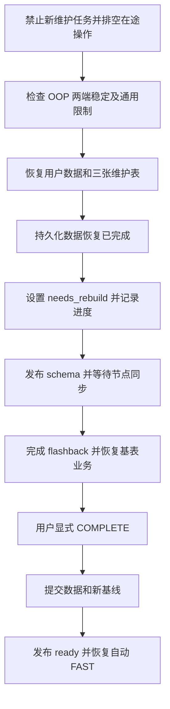
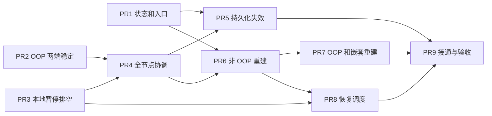

# MV Flashback Cluster 兼容性设计

- Author(s): [windtalker](https://github.com/windtalker)
- Status: Draft
- Discussion PR: 待创建
- Tracking Issue: 待创建
- Base Branch: `origin/feature/release-8.5-materialized-view`
- Base Commit: `239120dba89eb2121a9df94b74840fea7b7ccf17`
- Related Discussion: [MV 与 flashback 的兼容性讨论](https://pingcap.feishu.cn/wiki/P2ufwSE8wigQC1kSySOcEjwxncl)，方案 3

## Introduction

允许包含物化视图（MV）和物化视图日志（MLog）的集群执行受限的 `FLASHBACK CLUSTER`。用户数据和三张 MV 维护表一起恢复到目标时间，恢复后的 MV 进入 `needs_rebuild`，允许普通读取，禁止 FAST。用户显式执行 COMPLETE 建立新基线后，MV 恢复为 `ready`，重新允许 FAST。目标快照和开始恢复前均须处于 OUT OF PLACE（OOP）的稳定状态，允许恢复区间内存在已经完整结束的 OOP。

这一方案复用现有系统表恢复、build state 和 COMPLETE 主体，减少维护行重新构造和历史对象重新配对的工作。新增开发集中在恢复范围、OOP 准入、失效状态发布、后台任务隔离，以及 COMPLETE 成功后的状态发布。Purge 主逻辑原则上复用，验收其在恢复后的水位组合下能够安全推进。

## Motivation or Background

### 数据与维护信息的恢复范围不一致

当前 flashback 恢复用户表的数据和元数据，基表、MV、MLog 都在这个范围内。`mysql` 中大部分系统表的数据被排除，因此 MV 对象回到历史状态时，refresh、purge 和输入日志登记仍可能停留在当前状态。期间发生过 CREATE/DROP 时，还可能出现恢复了对象、却没有对应维护行的情况。

恢复系统表已有先例。[addToSlice](../../pkg/ddl/cluster.go) 允许 `mysql.stats_*` 和 `mysql.gc_delete_range` 随用户数据恢复。[现有 RealTiKV flashback 用例](../../tests/realtikvtest/flashbacktest/flashback_test.go)会检查 DROP INDEX 后新增的 `gc_delete_range` 记录在闪回后回退。因此，扩展三张 MV 表的恢复范围可以沿用现有 key range 和 TiKV flashback 机制，不需要另建系统表恢复框架。

### 仅恢复维护表不能恢复旧增量消费关系

Flashback 不会回退 PD 分配的时间戳。TiKV 将需要恢复的历史值写为新的 MVCC 版本，这些行可能获得本次 flashback 的新 commit TSO；不需要恢复的行仍可能保留原 commit TSO。FAST 通过 MLog 的 `_tidb_commit_ts` 和 `LAST_SUCCESS_READ_TSO` 选择增量，因此把维护表一起恢复，仍可能重复消费已经应用过的历史日志。

例如，基表和 SUM MV 原来都为 10。TSO 100 产生 `+20` 日志，TSO 200 的 FAST 将 MV 更新为 30。目标快照为 TSO 250，此时日志尚未清理；TSO 300 的 purge 删除日志。随后闪回到 250，假设恢复写入的 commit TSO 为 400，则日志重新可见且 `_tidb_commit_ts = 400`，恢复出的 refresh 水位仍为 200。直接 FAST 会再次应用 `+20`，使 MV 变成 50。

本方案通过失效保护阻止这次 FAST，再通过 COMPLETE 建立大于 400 的新基线。它不要求第一版恢复历史日志的逻辑身份或增加去重机制。

## Detailed Design

### 目标与边界

以物化视图分支的实现为基础，支持基表、MV、MLog 及三张维护表在同一目标时间恢复。恢复后，基表业务可以先继续运行，MV 逐个通过人工 COMPLETE 恢复。满足现有 flashback 限制及 OOP 两端稳定条件时，允许回退区间内的 MV/MLog CREATE/DROP 和已经完整结束的 OOP，不额外要求两端均无 MV/MLog。

第一版拒绝目标快照或开始恢复前存在未收尾的 OOP/shadow，保留现有 GC 安全点、目标时点 DDL、升级、TiFlash、placement 等限制。OOP 的 TiFlash/placement 资源保留复用 TRUNCATE 使用的延迟 GC 机制。第一版不增加自动 COMPLETE，不自动将失败的 FAST 转成 COMPLETE，不重新设计 purge，也不恢复整个 `mysql` schema 的定义。

术语和时间戳约定如下。

| 符号 | 含义 |
| --- | --- |
| `T` | 用户指定的 flashback 目标 TSO。 |
| `C` | 已禁止新维护任务并排空在途任务后、开始恢复前的有效检查时刻；检查通过后持续保持隔离。 |
| `F` | 本次 TiKV flashback 恢复写入使用的 commit TSO，即 `FlashbackClusterArgs.CommitTS`。 |
| `W_i` | 第 i 个 MV 恢复出的 `LAST_SUCCESS_READ_TSO`。 |
| `R_i` | 第 i 个 MV 在 flashback 后成功 COMPLETE 的计算快照 TSO。 |
| `H` | flashback 前的 purge history 中保存的旧 cutoff。 |

核心约束是 `W_i <= T < F < R_i`。NULL 水位继续按现有 purge 逻辑视作 0。恢复出来的旧水位可以保留作为保守边界，但在 COMPLETE 成功之前不得用于执行 FAST。

### 恢复三张维护表

在 `pkg/ddl/cluster.go` 的 `addToSlice` 中，为以下表增加明确的恢复例外。`getFlashbackKeyRanges` 和 `getTableDataKeyRanges` 继续负责生成完整表前缀范围，包含记录和索引。

| 表 | 恢复内容与作用 |
| --- | --- |
| `mysql.tidb_mview_refresh_info` | MV 的刷新水位、上次成功时间和下次调度时间，恢复维护行与 MV ID 的对应关系。 |
| `mysql.tidb_mlog_purge_info` | MLog 的 purge checkpoint 和调度信息，恢复维护行与 MLog ID 的对应关系。 |
| `mysql.tidb_mview_fast_refresh_source_info` | MV 注册的输入 MLog ID 集合，恢复历史计算基线对应的输入日志登记。 |

三张表与用户数据使用相同的 `T` 和同一次恢复协议。目标快照已经存在、当前被 DROP 的 MV/MLog，其维护行随之恢复；目标快照尚不存在、当前新增的对象及维护行随之回退。在现有系统表 DDL 和升级限制有效的前提下，不需要增加按当前对象重建维护行的修复流程。

Refresh/purge history 和 alert 表不加入本次恢复范围。它们保留操作历史；参与任务控制和安全边界判断的字段需要满足后文的验收要求。不能因为名称包含 history 就将其全部视为展示数据。

### OOP 两端稳定性检查

目标时刻 `T` 和开始恢复前的有效检查时刻 `C` 均须处于 OOP 稳定状态。稳定表示相关创建、装载、cutover 和失败清理已经结束，目录中没有进行中或遗留的 `MaterializedViewShadow`。不能仅以客户端 SQL 已经返回、当前没有 RUNNING 记录或没有 cutover job 作为判断依据。

| 检查位置 | 条件与处理 |
| --- | --- |
| 目标快照 `T` | 检查历史完整对象目录，存在 OOP shadow 等中间对象则拒绝；继续沿用目标时刻没有未完成 DDL 的通用检查。 |
| 开始恢复前 `C` | 先阻止所有节点上的新维护任务并排空在途操作，再检查当前目录；OOP 装载、IMPORT 工作、cutover 和清理均须退出，存在残留 shadow 则拒绝。 |
| 恢复区间 | 在通用限制允许时，可以跨越一次或多次已经完整结束的 OOP，也可以跨越已经完成清理的失败 OOP。 |
| 检查后的保护窗口 | 保持 DDL 互斥和维护任务隔离，直到数据恢复、needs_rebuild 持久化及 schema 同步完成。 |

OOP 的创建、装载和 cutover 不是一个连续存在的 DDL job；装载阶段可能没有活动 DDL job，因此两端检查需要覆盖 shadow 元数据和实际任务生命周期。发现不满足准入条件时，在 TiKV 恢复写入之前拒绝，并说明命中的快照、对象或未退出任务。

区间内出现 `ActionCreateMaterializedViewShadow`、`ActionMViewRefreshOutOfPlaceCutover` 或 `ActionDropMaterializedViewShadow` 本身不触发额外拒绝，`isFlashbackSupportedDDLAction` 无需为这三个动作增加黑名单。恢复到 cutover 前或后时，用户元数据、数据和三张维护表共同决定对应的 MV/MLog ID、依赖关系及维护行；恢复后的 MV 统一受失效保护。

Flashback 完成后可以显式执行新的 COMPLETE OUT OF PLACE 重建，按后文的规则在 cutover 中发布 ready。未来的 flashback 继续按两端状态和通用限制判断。

### 复用 TiFlash 和 placement 的资源保留机制

当前 OOP 已接入 TRUNCATE 使用的延迟 GC 流程。[OOP delete-range 登记](../../pkg/ddl/delete_range.go)将成功 cutover 后的旧 MV、旧 MLog ID 加入 `mysql.gc_delete_range`；[GC placement 清理](../../pkg/store/gcworker/gc_worker.go)已显式处理 `ActionMViewRefreshOutOfPlaceCutover`，统一回收退役 ID 的 TiFlash 和 placement 规则。cutover 后的即时清理只删除 TiFlash 进度缓存，旧规则的删除留到 GC。

新 shadow 和新 MLog 使用新物理 ID 创建各自的规则，原 ID 的规则保留到 GC。目标仍在合法 GC 范围内时，恢复到 cutover 前所需的旧对象及规则受现有保留机制保护。Flashback 本来就会恢复 `mysql.gc_delete_range`：目标之后产生的旧对象清理任务被回退，目标之前已经存在的清理任务则保持对应的历史状态。

[现有 OOP 规则回收测试](../../pkg/store/gcworker/gc_worker_test.go)覆盖无输出日志、有输出日志和取消时新旧 ID 规则的保留与删除。本方案沿用这些机制，将真实 TiFlash/placement flashback 接续纳入验收，不单列 OOP 专属的 PD 状态恢复开发。

### 沿用的通用 flashback 限制

新增 MV 恢复能力继续遵守下列已有条件：目标在 GC 有效范围内，满足当前 TSO 和集群 resolved-ts 校验；目标时刻没有未完成 DDL；当前没有其他 DDL 任务；恢复区间没有版本升级或不支持的系统表 DDL。

`isFlashbackSupportedDDLAction` 继续检查整个集群在目标时间至有效检查时刻之间的 schema diff，拒绝下列变化。

| 类别 | 被拒绝的 DDL 类型 |
| --- | --- |
| TiFlash 副本配置 | `ActionSetTiFlashReplica`：设置、删除或修改副本配置。 |
| TiFlash 副本状态 | `ActionUpdateTiFlashReplicaStatus`：副本可用状态变化，包括后台自动更新。 |
| Placement policy | `ActionCreatePlacementPolicy`、`ActionAlterPlacementPolicy`、`ActionDropPlacementPolicy`。 |
| Placement 绑定 | `ActionModifySchemaDefaultPlacement`、`ActionAlterTablePlacement`、`ActionAlterTablePartitionPlacement`。 |
| Attributes | `ActionAlterTableAttributes`、`ActionAlterTablePartitionAttributes`。 |

对象已有 TiFlash 副本或 placement policy 本身不触发额外拒绝。OOP/TRUNCATE 继承配置并切换物理 ID 沿用上述资源保留机制；若区间内另有副本配置、后台副本状态更新或上表中的其他 DDL，仍按通用检查拒绝。因此，跨已完成 OOP 的允许范围不意味着放开这些 DDL。

新增恢复协议要求所有参与的 TiDB 节点均支持该流程，混部期间不启用。Flashback 完成后，needs_rebuild 允许普通当前读；手动/自动 FAST 等待对应 MV 的显式 COMPLETE 成功及 ready 发布。原有 deferred/building、各 COMPLETE 模式适用条件和嵌套依赖规则保持有效。

### 复用 build state 表示刷新基线失效

复用 `MaterializedViewInfo.InitBuildState`，在 `pkg/meta/model/table.go` 的 `MViewInitBuildState` 枚举末尾追加 `needs_rebuild`。保持原有数值、`ready = 0` 和 `init_build_state` JSON 字段兼容性，补充 `String`、`AccessErrorMessage` 及字段注释。无需新增独立的 MV 失效标记表或系统变量。

Flashback 将恢复出的已构建 MV 置为 `needs_rebuild`，已经处于该状态的对象继续保持该状态。needs_rebuild 表示刷新基线需要重建，普通查询可以读取 MV 中已经提交的物化结果；该结果可能与当前基表不一致，查询不会自动按定义重新计算。原有 deferred/building 对象保留原来的不可读语义，不因恢复而变成 ready。重建执行期间继续保持 `needs_rebuild`，并复用现有 refresh 锁防止重复重建；读取沿用各 COMPLETE 模式已有的事务、锁和切换语义。

| 入口 | needs_rebuild 下的行为 |
| --- | --- |
| 普通 MV 当前读 | 允许，返回已提交的物化结果，可能与当前基表不一致。 |
| 手动 FAST 和 FAST AS OF TIMESTAMP | 拒绝，不能仅凭旧水位非 NULL 就继续刷新。 |
| 自动 FAST | 不派发该 MV，不自动转成 COMPLETE。 |
| 显式 COMPLETE | 放行，保持各刷新模式原有的适用条件和权限检查。 |
| SHOW、查看对象定义、DROP | 保持可用。 |

`pkg/planner/core/util.go` 的 `CheckMViewReadable` 需要区分读取许可和刷新许可：普通读放行 ready 与 needs_rebuild，继续拒绝原有 deferred/building。覆盖普通计划、PointGet、prepared statement 和计划缓存，避免将普通查询的放行扩大为 FAST 的放行。FAST 在执行入口检查最新状态，不能被缓存的旧 ready 元数据绕过。历史快照读继续遵守既有快照语义，不能用它绕过当前对象的 FAST 失效检查。

`pkg/executor/materialized_view.go` 的 `checkRefreshMaterializedViewReady` 当前会同时阻止 FAST 和 COMPLETE，需要改为根据状态及刷新模式判断。内部 maintenance bypass 允许重建操作所需的内部读写，但不能绕过 FAST 入口，也不能将失效上游 MV 作为下游重建的可信输入。

### 将失效发布纳入 flashback job

完整执行顺序如下。



现有 `onFlashbackCluster` 在 `StateWriteReorganization` 中完成恢复 RPC，随后发出异步通知并结束 job。本方案在恢复 RPC 和 job 完成之间增加持久化的 MV 失效阶段。不能仅依赖 `NewFlashbackClusterEvent` 的异步消费者设置状态。

在 `FlashbackClusterArgs` 中保存数据恢复、MV 失效处理和 schema 发布的阶段进度；MV 数量较多时，增加按 schema ID/table ID 排序的批次游标。失效更新与该批游标必须在同一个 DDL 事务中提交。这是 flashback job 的恢复进度，不是另一套 MV 可用状态。

| 阶段 | 持久化条件 | 重试行为 |
| --- | --- | --- |
| 恢复数据 | 沿用现有 StartTS、CommitTS、key ranges；所有范围恢复完成后，单独持久化完成阶段。 | 完成阶段提交前允许按现有协议重试 RPC，此时尚未开始写 MV 失效状态。 |
| 失效 MV | 从恢复后的目录读取对象，逐批设置状态并提交游标。 | 跳过数据恢复，只重复尚未完成的批次；重复写 needs_rebuild 幂等。 |
| 发布 schema | 全部对象处理完成后生成 schema version，执行节点同步。 | 重试发布和等待，不能重新执行数据恢复。 |
| 完成 job | 所需节点已同步失效状态，后台任务仍受隔离。 | 才允许结束 job，沿用 `finishFlashbackCluster` 恢复已有全局设置。 |

这样可以避免“已经写入 needs_rebuild，重试恢复 RPC 又将它覆盖成历史 ready”的问题。阶段和游标必须兼容当前 job 参数的 V1 位置编码与 V2 JSON 编码，不能只添加结构体字段而遗漏序列化路径。

在任何阶段失败、节点宕机或 DDL owner 切换时，都由持久化 job 继续推进。实际恢复已经发生后，不能将部分失效失败简单当作普通取消，再解除保护。数据恢复前的准入拒绝仍沿用原有取消和全局设置恢复路径。

Schema 发布必须使各节点实际加载恢复后带有 needs_rebuild 的 TableInfo，使普通查询使用正确的恢复对象、FAST 执行入口观察到最新限制。对批量元数据变化，不能假定一个没有列出相关表的普通 diff 就会更新所有缓存；实现时需要明确全量 reload 或受影响对象列表的路径。

### 隔离内部任务并重载调度

Flashback 执行期间，所有节点上的 refresh、purge、MLog analyze 及会修改相关维护状态的后台任务都必须停止接收新工作，并完成运行中任务的取消和退出。手动维护入口也需要相同的准入保护；OOP 的 IMPORT 装载工作、cutover 及清理也必须纳入排空。暂停确认以实际执行工作已经退出为准，发送取消请求或外层超时返回均不足以确认。普通读取在 flashback 执行期间沿用现有访问隔离，操作完成后不因 needs_rebuild 额外禁读。

持久化的 flashback DDL job 可作为正在恢复的判定依据。现有 DDL 提交流程已经通过 `pkg/ddl/systable/manager.go` 的 `HasFlashbackClusterJob` 检查活动 job；节点重启或新加入时，必须先建立该状态的判断，再启动 MVService 任务。具体的节点暂停确认应接入现有 domain/schema 同步路径，保证 owner 开始恢复前，参与节点已停止相关工作；仅发送一次异步通知不构成完成隔离。

复用现有任务取消、系统进程跟踪和执行器退出机制，补齐不能随 context 退出的路径。关闭普通 auto analyze、杀用户连接，都不能单独证明内部 MV 任务已经退出。运行中的非 OOP COMPLETE 也不能跨越 flashback 后再提交或发布 ready。

Flashback 完成后，重新加载三张维护表及对象目录，丢弃恢复前缓存的 refresh/purge/analyze 任务。`LoadAllTiDBMVRefresh` 和最终执行入口都需要检查最新状态，避免已排队 FAST 在状态变化后继续执行。COMPLETE 发布 ready 后通过现有通知及周期刷新重新调度；不永久抹掉用户原有的刷新定义。

恢复后的 purge 沿用保守水位规则，MLog analyze 可以恢复运行。只有需要重建 MV 的自动 FAST 继续跳过，不要求所有 MV 完成重建后才恢复整个 MVService。

### COMPLETE 提交后再发布 ready

COMPLETE 使用 flashback 完成后的新计算快照 `R`，满足 `R > F`。计算快照必须来自本次重建，不能复用恢复前保存在 session 或旧任务中的值。Ready 发布恢复 FAST 能力，普通读取不等待 ready。现有 refresh 权限、锁、调度表达式和各模式的适用条件保持有效。

物化视图分支的非 OOP COMPLETE 已在同一事务中更新 MV 数据、refresh 成功水位及输入 source-info 登记，复用这段主体。成功提交之后，再通过 DDL 持久化状态修改和 schema 同步将目标发布为 ready。新的发布路径应校验 MV ID、revision、当前失效状态与本次已提交的计算基线，防止旧任务对变化后的对象发布 ready。

如果重建事务失败，保留 needs_rebuild，普通读取沿用已有提交结果，FAST 继续拒绝。若事务已经提交、ready 发布之前失败，普通查询可以读取已经提交的重建结果，FAST 仍保持禁止；允许重新执行 COMPLETE 或恢复已持久化的状态发布 job。数据已重建但 FAST 尚未启用是安全的中间状态，数据和基线尚未提交时提前发布 ready 则不安全。

恢复日志的 commit TSO 不大于 `F`：未重写行保留更早的时间戳，需要重写的行使用本次 `F`。新 FAST 从 `R > F` 开始，因此不会再次应用这些历史日志。重建快照之后的基表写入则仍需由后续 FAST 消费，不能通过直接清空整个 MLog 来清理旧日志。

OUT OF PLACE 继续复用 shadow 装载、refresh/source-info 迁移和 cutover 事务。`onRefreshMaterializedViewCompleteOutOfPlaceCutover` 当前克隆旧 `MaterializedViewInfo`，需将成功重建的新 MV 显式置为 ready，避免继承旧 needs_rebuild。新对象的状态与基线在 cutover 中一起发布。

嵌套 MV 按上游到下游的顺序重建。上游仍失效时，拒绝下游 COMPLETE，并提示先恢复上游；普通查询允许读取 needs_rebuild 的 MV，不代表下游重建可以把它当作可信输入，内部 maintenance bypass 也不能解除这个限制。上游使用 OOP 重建后，下游必须使用切换后的依赖及 source-info。已有的 IN PLACE 对自身带 MLog 的 MV 的限制继续生效。

### Purge 复用的水位推导

不统一清空恢复出的 refresh/purge 水位，不将 needs_rebuild 的 MV 从 purge 的依赖集合中移除。现有 `calcMaterializedViewLogSafePurgeTSO` 使用依赖 MV 的最小水位，并以 purge 自身 start TSO 为上限：

```text
safePurgeTSO = min(purgeStartTSO, W_1, W_2, ..., W_n)
```

Flashback 前的历史 purge cutoff `H` 小于本次 `F`，因为旧任务已经在恢复前退出，其 cutoff 不会超过其事务 start TSO。恢复出的旧 MV 水位满足 `W_i <= T < F`。只要还有未重建的依赖 MV，它的旧水位就会保住闪回之后生成的日志。

Purge 还会读取未恢复的 `tidb_mlog_purge_hist`：`readLatestMLogPurgeCutoffFenceTSO` 提供单调 cutoff，FAST 的完整性检查还会读取 hazardous cutoff。如果旧 history fence 高于恢复后的安全水位，现有代码会跳过删除，结果是保守积压而非越过安全水位清理。

所有相关 MV 重建后，各新水位满足 `R_i > F > H`。后续 purge 的 start TSO 也在 `F` 之后，旧 fence 本身不会永久阻止 purge；新的 FAST 基线同样已经越过旧 hazardous cutoff。多个 MV 共享 MLog 时，只有部分 MV 重建仍可能因其他 MV 的旧水位积压，这是第一版接受的行为。NULL 水位继续按 0 处理。

以上推导依赖恢复前任务已经隔离、恢复后所有相关 MV 均受失效保护，以及 COMPLETE 确实使用 `R > F`。这些前提纳入场景验收。Purge 主逻辑不预设为开发改动，只验证“重建前保住接续日志、相关 MV 重建后恢复清理”。History 中旧 RUNNING 记录继续按已有回收规则处理，不能使旧任务恢复执行或影响新任务身份。

### 开发改动清单

| 改动 | 代码落点 | 交付行为 |
| --- | --- | --- |
| 三表恢复白名单 | `pkg/ddl/cluster.go` | 三张维护表的数据和索引随用户数据一起恢复。 |
| OOP 准入 | `pkg/ddl/cluster.go`、snapshot 元数据检查 | 检查目标快照及排空后的当前状态，拒绝未收尾 OOP/shadow；通用限制允许时跨越已完成的 OOP。 |
| 状态与入口 | `pkg/meta/model/table.go`、`pkg/planner/core/util.go`、`pkg/executor/materialized_view.go` | 扩展 build state，needs_rebuild 允许普通读、拒绝 FAST，允许恢复用 COMPLETE；保留 deferred/building 的读取限制。 |
| 持久化失效阶段 | `pkg/ddl/cluster.go`、`pkg/meta/model/job_args.go`、schema 同步路径 | 明确恢复 RPC 与失效发布的持久化边界，支持批次、重启及 owner 切换。 |
| Ready 发布 | `pkg/executor/materialized_view.go`、DDL job/worker、`pkg/ddl/table.go` | 非 OOP 在成功事务之后发布 ready；OOP 在 cutover 中发布，保持对象及基线校验。 |
| 调度协调 | `pkg/mvservice/service.go`、`pkg/mvservice/service_helper.go`、domain 通知路径 | 隔离和排空旧任务、重载恢复后的任务，跳过失效 MV 的自动 FAST。 |
| TiFlash/placement 复用 | 现有 OOP delete-range、GC 和 flashback 通用准入路径 | 沿用延迟 GC 和原有 DDL 限制，验收旧对象恢复后的规则及副本行为，不单列 OOP 专属恢复模块。 |
| 验收与说明 | 现有 DDL、refresh、MVService 和 RealTiKV flashback 用例 | 验证恢复、失败重试、依赖顺序与 FAST/purge 接续，说明用户恢复流程。 |

### PR 拆分与交付顺序

实现拆为 9 个 PR，设计文档单独提交。每个实现 PR 包含对应的针对性测试，最后一个 PR 负责接通生产入口并完成跨模块验收。工作量按相对复杂度评估；跨节点隔离、持久化失效和 COMPLETE 的状态发布需要优先确定接口。

| PR | 建议标题 | 开发范围与验收条件 | 依赖 | 相对工作量 |
| --- | --- | --- | --- | --- |
| PR1 | `meta, planner, executor: add needs-rebuild state for materialized views` | 追加 build state，保持 ready 零值和旧元数据兼容；普通读、PointGet、prepared statement 和计划缓存放行 needs_rebuild，FAST/有界 FAST 继续拒绝。原有 deferred/building 的读取限制保持有效；恢复用 COMPLETE 的放行和 ready 发布由 PR6/PR7 一起交付。 | 无 | 中 |
| PR2 | `ddl: check out-of-place refresh stability before flashback` | 检查目标快照和当前目录的 OOP 中间状态及残留 shadow，覆盖装载期间没有活动 DDL job 的窗口。允许区间内已完整结束或已完成失败清理的 OOP，保留通用 TiFlash/placement DDL 限制；最终检查与任务隔离的先后顺序由 PR4 接入。 | 无 | 中 |
| PR3 | `mvservice: support pausing and draining maintenance tasks` | 实现本节点的任务暂停、排空和恢复能力：停止新任务入队、清理待执行任务、取消或等待在途 refresh/purge/analyze 及相关维护写入；任务真实退出后才确认排空。恢复时先清理旧队列；恢复后的元数据加载策略由 PR8 接入。 | 无 | 大 |
| PR4 | `ddl, domain, executor: coordinate materialized view tasks during flashback` | 将 PR3 接入 flashback 的全节点协调；覆盖持久化 job 判定、节点暂停确认、重启/新加入节点准入及手动维护入口，普通读取在操作期间沿用 flashback 访问隔离。在途 OOP 的装载、IMPORT、cutover 和清理退出后，才做两端稳定性检查及 TiKV 恢复；解除保护接入 PR5 的失效发布边界，完成后 needs_rebuild 允许普通读。包含协议支持检查，混部时拒绝进入新流程。 | PR2、PR3 | 大 |
| PR5 | `ddl: persist materialized view invalidation during flashback` | 扩展 job 参数及 V1/V2 编码，持久化“数据已恢复—失效标记—schema 发布”阶段和批次游标；标记与游标在同一 DDL 事务提交，全部节点加载失效元数据后才允许完成 job。覆盖 RPC 重试、批次中断、owner 切换及 schema 同步失败，保证失效写入后不重放恢复 RPC。 | PR1、PR4 | 大 |
| PR6 | `executor, ddl: rebuild invalidated materialized views with complete refresh` | 放行 needs_rebuild 下适用的非 OOP COMPLETE，复用数据、水位和 source-info 的原子提交，再通过持久化元数据路径发布 ready；校验对象身份及本次已提交基线，拒绝依赖失效上游的重建。覆盖新快照 R > F、失败保留失效、提交后发布前故障、重复重建及旧任务不能解除新一轮失效；OOP 的恢复入口留到 PR7 放行。 | PR1、PR4 | 大 |
| PR7 | `executor, ddl: support out-of-place rebuilds after flashback` | 接通 COMPLETE OUT OF PLACE 的恢复入口，在 cutover 中对新对象显式发布 ready，保持 refresh/source-info 和依赖迁移一致；复用 PR6 的上游状态检查，补齐嵌套 MV 在上游 OOP 后的新对象和日志绑定。保持各 COMPLETE 模式原有条件，验证按依赖顺序重建。 | PR6 | 中 |
| PR8 | `mvservice: reload maintenance schedules after flashback` | 将暂停恢复接到最新目录和维护表的重新加载，丢弃旧任务；加载与执行入口都跳过 needs_rebuild 的自动 FAST，COMPLETE 发布 ready 后重新调度。Flashback 完成后允许 purge/analyze 恢复，保留用户调度定义，沿用旧 history 的回收及 alert 的重载、清理。 | PR3、PR6 | 中 |
| PR9 | `ddl: enable flashback recovery for materialized views` | 将三张维护表的数据和索引加入恢复范围，接通完整流程，确认协议支持及解除保护的顺序；完成真实 TiKV、多节点及节点重启、owner 切换的验收，补齐用户说明。覆盖三表与对象的 CREATE/DROP 对齐、跨已完成 OOP、重复消费反例、所有 COMPLETE 模式及 FAST/purge 接续；验证 TiFlash/placement 规则和 gc_delete_range 回退沿用现有机制，通用拒绝规则保持有效。 | PR5、PR7、PR8 | 大 |

依赖关系如下；箭头表示合入前需要具备的代码能力。



PR1、PR2、PR3 可以并行开发。PR4 完成隔离协议后，PR5 和 PR6 可以在对象身份、失效轮次校验及 schema 发布约定明确后并行推进；PR7 和 PR8 在 PR6 之后可以并行。PR4/PR5 会修改同一 flashback worker，PR5/PR6/PR7 共享部分 DDL 元数据和参数代码，PR3/PR8 共享 MVService 文件，合入时需要按依赖顺序 rebase。

PR3 的暂停确认必须包含执行器中真正仍在运行的任务，不能在发送取消请求或外层超时返回时就报告完成。PR4 负责全节点确认及手动入口，PR5 负责恢复后持续保护到失效状态同步；这三个 PR 共同构成 flashback 的保护窗口。对恢复前即可安全取消的拒绝和恢复已经发生后的继续推进，需分别验证解除保护的时机。

三表恢复白名单在 PR9 与完整新流程一起接入生产入口，之前通过针对性测试调用已实现的模块。PR1 至 PR8 分别合入不代表已经交付 MV flashback 支持；接通时必须同时具备任务隔离、OOP 准入、持久化失效、可用的 COMPLETE 恢复、调度重载和协议检查，避免三表先恢复、旧 FAST 已经继续运行的中间状态。

Purge 主逻辑不单独安排开发 PR。PR8 保证失效 MV 仍参与依赖和保守水位判断，PR9 用真实恢复链路验收重建前保留日志、相关 MV 全部重建后继续清理。若用例暴露现有逻辑不满足这些约束，再针对实际问题补充修复。

### 用户恢复流程

在可闪回的 GC 时间范围内选择目标，确认目标快照不存在未收尾 OOP/shadow，并沿用已有 flashback 操作流程。系统在禁止新维护任务、排空在途操作后检查当前端；满足通用限制时，区间内已经完整结束的 OOP 不额外阻止恢复。以下 SQL 中的时间是用户实际选定的合法目标；MV 名称也替换为实际对象。

```sql
FLASHBACK CLUSTER TO TIMESTAMP '<target_timestamp>';
SELECT * FROM app.mv; -- 允许读取已提交的物化结果，可能与当前基表不一致
REFRESH MATERIALIZED VIEW app.mv COMPLETE DELTA APPLY;
SELECT * FROM app.mv;
REFRESH MATERIALIZED VIEW app.mv FAST;
```

Flashback 返回成功后，基表业务和 needs_rebuild 下的普通 MV 读取可以恢复，查询返回 MV 中已提交的物化结果，可能与当前基表不一致。尚未重建的 MV 的 FAST 返回明确错误；每个 MV 的 COMPLETE 成功并完成 ready 发布后，后续 FAST 从新水位继续。嵌套 MV 先处理上游。用户也可以 DROP 不再需要的 MV，解除其对日志保留水位的约束。

## Test Design

### Functional Tests

为三张表的恢复例外、OOP 两端稳定性和通用准入增加针对性用例。覆盖两端 shadow 拒绝、装载期间没有活动 DDL job、区间内已完成 OOP 不额外拒绝，以及 TiFlash 配置/自动状态更新和 placement DDL 继续触发原有拒绝。扩展现有 build state 与读/refresh 入口测试，覆盖 ready、needs_rebuild 和原有 deferred/building：needs_rebuild 普通读允许、FAST 拒绝，deferred/building 的读取继续拒绝，恢复用 COMPLETE 不再被统一的 ready 检查拒绝。

验证三种 COMPLETE 模式的状态迁移，保持原有适用条件。检查 ready 枚举仍为 0、新状态序列化往返正确、旧元数据缺省字段仍表示 ready。非 OOP 的 ready 发布必须晚于数据/水位/source-info 事务提交；OOP 的新 MV 不能继承旧 needs_rebuild。

### Scenario Tests

| 场景 | 预期 |
| --- | --- |
| Flashback 完成，MV 处于 needs_rebuild | 普通查询、PointGet、prepared statement 和缓存计划允许读取已提交的物化结果；FAST 拒绝，自动 FAST 跳过。 |
| 已消费日志在目标之后被 purge，再实际 flashback | 重建前 FAST 被拒绝；COMPLETE 后 FAST 不重复应用旧日志，MV 与定义查询一致。 |
| 区间内 CREATE/DROP MV/MLog | 对象、三张表的维护行及 source-info 索引一致回退。 |
| 区间内一次、多次完整结束或已经完成失败清理的 OOP | 两端稳定且满足通用限制时允许恢复；MV/MLog ID、依赖及三表回退一致，COMPLETE 后可以接续 FAST。 |
| 目标快照存在 shadow，或当前 OOP 创建、装载、切换、清理未退出及残留 shadow | 排空和检查后仍不稳定则在实际恢复前拒绝，不遗漏没有活动 DDL job 的装载窗口，也不让 IMPORT 工作越过恢复边界。 |
| OOP 继承 TiFlash/placement 配置后恢复到 cutover 前或后 | 旧/新对象规则符合对应快照，恢复的 gc_delete_range 不误删重新可用的旧对象；副本读与 TiKV 结果一致。 |
| 区间内 TiFlash 副本配置/自动状态更新或 placement/attributes DDL | 继续按原有通用检查拒绝，不因允许跨已完成 OOP 而放宽。 |
| 恢复 RPC 完成但阶段尚未提交时宕机 | 安全重试恢复；尚未开始失效写入。 |
| 部分 MV 已失效、owner 切换 | 从持久化阶段和游标继续，不重放恢复覆盖失效状态，不提前开放访问。 |
| COMPLETE 提交前失败或取消 | 保持 needs_rebuild，无部分成功可见。 |
| COMPLETE 已提交、ready 尚未发布时失败 | 普通读可见已提交的重建结果，FAST 仍被禁止，重试后正确发布；旧任务无法解除新一轮失效。 |
| 重建时基表继续写入 | 新基线后的增量保留，接续 FAST 后结果正确。 |
| 多 MV 共享 MLog，仅部分完成重建 | 保守保留日志；全部重建或删除相关依赖后继续 purge。 |
| 嵌套 MV，上游未重建或使用 OOP 重建 | 拒绝过早的下游重建；按依赖顺序恢复后结果与 source-info 正确。 |
| 保留旧 purge history | 旧 fence 只会保守跳过；新基线建立后 FAST 与 purge 均可继续。 |
| 多节点旧队列、运行中维护、节点重启 | 隔离覆盖所有任务，恢复后重载元数据，不执行旧基线工作。 |

真实恢复链路放在 `tests/realtikvtest/flashbacktest`，不能仅通过 SQL 手工模拟恢复行和水位代替。至少覆盖重复消费反例、CREATE/DROP 三表一致性、跨已完成 OOP、持久化阶段恢复和重建后 FAST/purge 接续；TiFlash/placement 场景需要相应真实组件参与。实现阶段按仓库 testing flow 启动并清理 playground，启用和恢复 failpoint，再运行针对性用例。

### Compatibility Tests

覆盖普通查询、PointGet、prepared statement、计划缓存和内部 SQL，确保 needs_rebuild 的普通读取放行，FAST 不能通过旧 ready 元数据绕过限制，deferred/building 继续不可读。保持权限检查、各 COMPLETE 模式既有条件，以及 TiFlash/placement、GC 和升级检查原有的行为，不因 MV 维护表白名单而放宽它们。

新增 flashback 子阶段涉及 job 参数编码和恢复，测试 V1/V2 参数的兼容解码与默认值。新增流程仅在所有参与节点支持该协议时运行；滚动升级混部期间不启用。存在活动恢复 job 或尚未处理的 needs_rebuild 时，不能将降级当作解除状态保护的办法。

### Benchmark Tests

度量失效标记阶段随 MV 数量增长的时间、DDL 事务大小和 schema reload 成本，用于选择批次大小。观察共享 MLog 在部分 MV 长时间未重建时的积压。保持正常 ready MV 的状态检查开销较小，不为每次读取增加无界的全目录扫描；不以本设计预估固定性能收益。

## Impacts & Risks

### Impacts

用户可以先恢复基表业务并读取恢复出的 MV 物化结果，再安排 MV 的 COMPLETE。needs_rebuild 允许普通读，结果可能与当前基表不一致；该状态继续禁止 FAST，直到 COMPLETE 建立新基线并发布 ready。系统表恢复沿用现有机制，无需修改表 schema 或增加一套维护行重建框架。

恢复业务前增加 MV 失效标记和 schema 同步阶段。未重建依赖会延长 MLog 保留时间；用户通过 COMPLETE 或 DROP 解除。COMPLETE 仍可能消耗较多资源，因此仅由用户显式发起。

### Risks

主要正确性风险是失效发布过晚、重试恢复覆盖新状态、旧维护任务跨越 flashback、COMPLETE 未提交就发布 ready，以及下游读取未恢复上游。持久化阶段、任务隔离、对象/基线校验和依赖顺序分别约束这些路径，必须通过故障注入和真实 TiKV 场景验证。

保留的 purge history 与恢复后的 info 来自不同时间，安全性依赖前述水位关系；若存在违反推导前提的路径，应修复该路径，而不是直接清空整个 MLog。大规模目录标记和全量 schema reload 可能延长恢复窗口，批处理也不能放松全部 FAST 保护状态同步后才解除恢复期隔离的约束。允许普通读不代表 MV 已与当前基表同步，也不能据此跳过下游重建的上游状态检查。

旧版本 DDL owner 不理解新增 job 阶段，混部执行可能跳过失效发布。因此协议支持检查和滚动升级边界属于交付条件；保持 ready 的零值兼容不能替代该检查。

## Investigation & Alternatives

有 MV/MLog 就前置拒绝的方案实现最小，但会限制整个集群的闪回能力，无法满足先恢复基表、之后重建 MV 的需求。只将 refresh 水位置 NULL 可以阻止 FAST，仍需处理缺失的维护行及输入日志登记。方案 3 通过三表恢复对齐历史对象，并以 needs_rebuild 显式记录刷新基线需要重建；普通读取保持可用。

仅恢复三张维护表可以解决目录与维护行错位，却不能消除物理 commit TSO 变化造成的重复消费。本方案在此基础上增加 needs_rebuild 和 COMPLETE；两端稳定时，已完成 OOP 的 ID 切换由相同目标快照恢复，TiFlash/placement 资源沿用延迟 GC。第一版聚焦失效和重建，不接管目标快照中的未完成 OOP，也不恢复旧任务或增加旧日志的增量身份去重机制。

`mysql.stats_*` 和 `mysql.gc_delete_range` 说明系统表数据参与 flashback 已有实现先例。Oracle 的物理 Flashback Database 与这里的 MVCC 恢复机制不同；本方案的读取许可、FAST 限制和重建语义由 TiDB 自身的恢复方案定义，不从其他系统的状态名称直接推导。

## Unresolved Questions

节点暂停与排空的具体确认点需要在实现时与 domain/schema 同步路径共同确定，并验证手动维护和新加入节点也在覆盖范围内。必须保持“参与节点已隔离后才恢复、全部失效状态同步后才开放”的协议约束，不能用最终一致的通知代替。

失效批次大小、游标编码和 schema reload 方式需要根据目录规模实验确定。非 OOP COMPLETE 的 ready 发布使用专门的元数据 DDL job，具体 action 和参数命名在实现时确定；其对象身份、revision 与已提交基线校验不能省略。上述接口需要按活动 flashback job 和已有 refresh 锁的互斥关系安排，防止状态发布与新的 flashback 交叉。

## References

- [物化视图分支代码快照](https://github.com/pingcap/tidb/tree/239120dba89eb2121a9df94b74840fea7b7ccf17)。
- [Flashback 范围、准入及 worker](../../pkg/ddl/cluster.go)。
- [Build state 定义](../../pkg/meta/model/table.go)和[现有读取保护](../../pkg/planner/core/util.go)。
- [Refresh 事务、purge 水位和历史 fence](../../pkg/executor/materialized_view.go)。
- [输入日志登记与替换](../../pkg/util/mviewutil/refresh_source.go)、[计算快照校验](../../pkg/executor/mview_refresh_source.go)。
- [OOP cutover 和状态克隆](../../pkg/ddl/table.go)。
- [OOP 旧对象 delete-range 登记](../../pkg/ddl/delete_range.go)、[TiFlash/placement 延迟 GC](../../pkg/store/gcworker/gc_worker.go)及[现有规则回收测试](../../pkg/store/gcworker/gc_worker_test.go)。
- [MVService 调度与任务加载](../../pkg/mvservice/service.go)、[维护入口](../../pkg/mvservice/service_helper.go)。
- [RealTiKV flashback 用例](../../tests/realtikvtest/flashbacktest/flashback_test.go)。
- [TiKV 8.5.4 flashback 恢复写入](https://github.com/tikv/tikv/blob/v8.5.4/src/storage/txn/actions/flashback_to_version.rs#L30-L138)。
