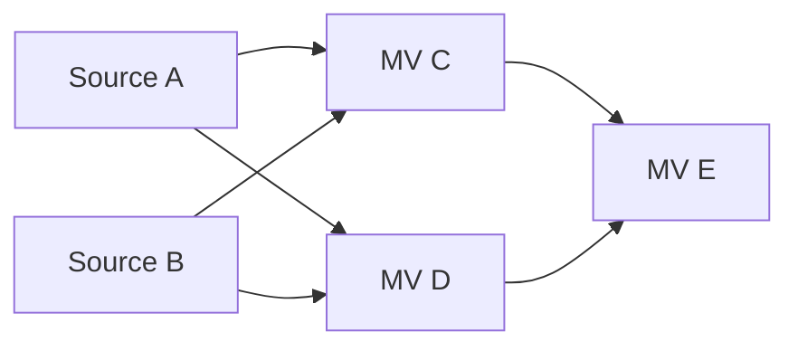

# 物化视图日志连续性与 OOP 刷新设计

**状态：设计草案，待讨论，尚未实现**
**日期：2026-10-13**
**更新日期：2026-10-16**
**适用分支：`nested_mv`**

本设计支持已有自身 MLog 或下游 MV 的物化视图执行 `COMPLETE OUT OF PLACE`。
OOP 成功后，下游仍可查询已有数据，但旧的增量消费基线失效；下游通过 COMPLETE
重新建立基线，再恢复 FAST。普通 COMPLETE 的基线恢复只更新运行状态，不增加 DDL 流程。

状态模型按 source 与 MV 的多对多关系设计。当前 SQL 仍只支持单 source，单 source
使用同一套协议的一条入边；未来多 source SQL 和增量计算算法不应要求重做失效与恢复机制。
本次不支持普通表 TRUNCATE，也不放开对 MV、MLog 内部存储对象的直接 TRUNCATE。

MLog 代际是通用机制，是否推进代际由操作语义决定。当前设计范围内，普通表尚不支持
会导致其 MLog 代际变化的操作；MV 的 COMPLETE OUT OF PLACE 会导致其自身 MLog
代际推进。普通表 DML、MV FAST 和 COMPLETE DELTA APPLY 均保持对应 MLog 的代际不变。

FAST 和 COMPLETE DELTA APPLY 保留现有 `for_update_ts` 数据读取路径。刷新按实际读取
快照确认日志身份，不要求 source 状态一直保持不变到刷新提交；consumer 不对上游
MLog info 行加锁。不换 MLog ID 时按快照比较 generation；换 ID 时按快照校验 MLog
绑定，两种方案都保留逐 source 的消费基线。

## 1 背景与设计边界

### 1.1 当前分支行为

[已交付的 nested MV 实施计划](mv_nested_implementation_plan_zh.md)记录了当前能力：

- ready MV 可以拥有 MLog，并作为另一 MV 的 source。
- FAST 和 COMPLETE DELTA APPLY 在同一事务中更新目标 MV 并写入其自身 MLog。
- 已有自身 MLog 的 MV 拒绝 COMPLETE IN PLACE；有自身 MLog 或 child 的 MV 拒绝 OOP。
- 依赖关系按对象 ID 保存，parent-first 刷新顺序由调用方保证。

当前拒绝 OOP 的主要原因有两项：全量替换没有产生下游所需的完整 delta；cutover 使用
shadow table ID 替换原 MV ID，尚未迁移其自身 MLog 和下游引用。
[cutover worker](../../../pkg/ddl/table.go)的入口为
`onRefreshMaterializedViewCompleteOutOfPlaceCutover`。

本设计是后续扩展，不改变已有实施计划对当前实现的描述。

### 1.2 本次范围

1. 支持受控 MV 写入下的 parent OOP、下游 FAST 失效及 COMPLETE 恢复。
2. 从一开始表达多个 source、多个 consumer，以及同时作为 consumer 和 source 的中间层 MV。
3. 迁移 cutover 涉及的结构依赖和运行基线，并保证 schema 与运行状态原子提交。
4. 将日志保留、刷新提交、initial build、drop、rollback 和升级纳入同一协议。
5. 保持现有 SQL 语法；不隐式将失败的 FAST 降级成 COMPLETE。

本次不实现多 source SQL、join 增量算法、自动级联、依赖图调度、严格的传递 freshness
保证或普通表 TRUNCATE。COMPLETE IN PLACE 在带自身 MLog 的 MV 上保持现有限制。

### 1.3 MV 写入受控是 OOP 的前置条件

parent OOP 持有目标 MV 的维护排他权，等待已有 refresh 数据事务结束后，阻止其他
FAST、DELTA APPLY 和会修改该 MV 数据的维护入口进入切换临界区。shadow build 不是
对 serving MV 的写入，也不向 serving MV 的 MLog 追加历史数据。

划分新旧日志代际前，需要确认对目标 MV 的旧 refresh 数据事务及其自身 MLog 写入已经
结束。切换完成后的写者必须重新解析新 MV 身份和 MLog 绑定。物理 MV ID 改变时，维护锁
与 schema 发布的交接也必须维持这个保证，不能仅假设使用旧 ID 的 advisory lock 会自动
覆盖新 ID。

以 `t -> mv1 -> mv2` 为例，`MLog(t)` 的直接 source 是普通表 t，随用户 DML 持续写入；
`MLog(mv1)` 的直接 source 是 mv1，随 mv1 的 refresh 写入。对 mv1 执行 OOP 时，
需要控制的是 mv1 与 `MLog(mv1)` 的写入，并推进 `MLog(mv1)` 的代际。上游 t 的 DML
及 `MLog(t)` 写入可以继续，`MLog(t)` 的代际不变，快照之后的变化仍供 mv1 后续 FAST 消费。

普通表有任意用户写事务；它们可能跨过 TRUNCATE 的切换边界。仅递增 generation
不能证明这些写事务及日志属于正确的 source 实例。因此普通表 TRUNCATE 不属于本次
支持范围，也不作为本设计已经解决的并发问题。

## 2 OceanBase 参考与 TiDB 的差异

参考版本为 OceanBase `v4.4.2_CE_BP2`，commit
`e9fc1e5f01f0cf7cc3a801af6c2c05c34d491d77`。

OceanBase 在 `__all_mview_dep` 的每条依赖记录中保存
`IS_COMPLETE_REFRESH_ONLY_FLAG`。切换时替换依赖的容器表 ID 并置位，FAST 检查该标记，
COMPLETE 成功时重建目标 MV 自己的依赖记录，使其再次支持 FAST。这提供了按消费者
独立恢复的语义。[标记定义](https://github.com/oceanbase/oceanbase/blob/e9fc1e5f01f0cf7cc3a801af6c2c05c34d491d77/src/sql/resolver/mv/ob_mv_dep_utils.h#L37)、
[切换时置位](https://github.com/oceanbase/oceanbase/blob/e9fc1e5f01f0cf7cc3a801af6c2c05c34d491d77/src/sql/resolver/mv/ob_mv_dep_utils.cpp#L604)、
[FAST 检查](https://github.com/oceanbase/oceanbase/blob/e9fc1e5f01f0cf7cc3a801af6c2c05c34d491d77/src/sql/resolver/mv/ob_mv_provider.cpp#L427)、
[依赖重建](https://github.com/oceanbase/oceanbase/blob/e9fc1e5f01f0cf7cc3a801af6c2c05c34d491d77/src/rootserver/mview/ob_mview_dependency_service.cpp#L197)

OceanBase 保留逻辑 MV ID，切换它的 `data_table_id`，并为新容器重建 MLog。容器、依赖、
刷新信息的切换属于同一个 DDL 事务；切换前也检查构建依赖的 schema version。
[OOP 实现](https://github.com/oceanbase/oceanbase/blob/e9fc1e5f01f0cf7cc3a801af6c2c05c34d491d77/src/rootserver/ob_ddl_service.cpp#L23856)

TiDB 当前的 MV ID 就是物理 table ID，OOP 会改变它。本设计沿用按依赖独立恢复的契约，
但使用日志代际与消费基线表达有效性；不将需要频繁确认的运行状态放进 `TableInfo`。
普通 COMPLETE DELTA APPLY 可以通过数据事务恢复入边基线，无需额外 schema 变更。

## 3 多对多模型与核心不变量



source 指普通物理表或 ready MV。边 `S -> M` 表示 M 的定义直接读取 S。
结构图中的一条边对应一条消费基线；同一 source 被多个 MV 使用时，每个 consumer
有自己的记录。同一 source 在 SQL 中出现多次，不以 SQL alias 重复建立消费基线。

本设计采用以下不变量：

1. `TableInfo` 是结构依赖的权威定义；运行基线表不能单独建立或删除结构依赖。
2. 结构边集合与运行基线记录集合一致；缺行、重复身份或无效绑定不能被 FAST 默认为有效。
3. 日志身份由 `(MLOG_ID, LOG_GENERATION)` 共同确定。新建 MLog 即使 generation 相同，
   也不能继承旧 MLog 的有效基线。
4. FAST 要求所有入边在实际计算快照上具有有效基线，且日志覆盖各自的消费区间。
5. 一次成功刷新原子提交目标数据、自身 MLog、全部入边基线和整体刷新成功信息。
6. COMPLETE 确认的是实际读取的 source 身份和日志代际；不能确认提交时新看到的代际。
7. OOP 原子切换对象身份、结构依赖、日志代际和基线记录的键。任一步失败都不能留下
   已切换的部分运行状态。
8. 目标维护排他权保证同一 MV 写入串行；consumer 按实际快照校验上游身份并原子确认
   基线，不对上游 MLog 状态建立提交屏障。对象引用和基线改键仍受正常冲突检查保护。

### 3.1 有效性判定

对一条结构边 `S -> M`，设普通 FAST 实际计算快照为 `U`，定义：

```text
At(S, U) = (source_id, mlog_id, generation, generation_start_tso) @ U
Used(M, S) = 本次计划实际读取的 source / MLog 物理身份
Baseline(M, S) = (baseline_mlog_id, baseline_generation, read_tso)

Valid(M, S, U) =
    Used(M, S) 与 At(S, U) 的 source / MLog 绑定一致
    AND baseline 各字段非 NULL
    AND baseline_mlog_id == Used(M, S).mlog_id == At(S, U).mlog_id
    AND baseline_generation == At(S, U).generation
    AND read_tso >= At(S, U).generation_start_tso
    AND 日志保留与 purge 完整性检查通过

CanFast(M, U) = 对所有结构入边 S -> M，Valid(M, S, U) 均成立
```

generation 匹配只能证明未跨过已声明的日志断点，不能代替 purge 完整性检查。
`At(S, U)` 使用快照上的状态，不是校验执行时的最新值。若 source 在 `U` 之后切换，
本次只能确认 `U` 上的旧身份，后续 FAST 会识别基线失效；能否提交仍受对象和基线记录的
正常冲突检查约束。第 5.4 节的纯换 ID 方案可省略 generation 条件。
`CanFast` 也不表示所有祖先数据已经最新；parent-first 刷新顺序仍由调用方保证。

### 3.2 状态由基线推导

| 状态 | 判定 | 允许的恢复 |
| --- | --- | --- |
| 未建立基线 | 基线字段为 NULL | initial build 或 COMPLETE |
| 有效 | 检查快照上的日志身份、边集合和保留范围均匹配 | FAST 或 COMPLETE |
| 需要 COMPLETE | 代际、MLog 身份不匹配，或消费区间存在日志缺口 | COMPLETE |
| 元数据不一致 | 应有记录缺失、owner 不匹配或出现多余边 | 报一致性错误，先恢复有效结构与运行记录 |

不保存整个 MV 的 `REQUIRES_COMPLETE_REFRESH` 布尔值，也不通过手工修改 generation
匹配值来恢复 FAST。运行记录必须由实际的数据构建结果建立。

## 4 持久化布局

以下表名和字段是草案，尚未加入 bootstrap 或 schema model。

### 4.1 结构依赖继续保存在 TableInfo

现有字段已经按 ID 集合表达正反向关系：

- consumer 的 `MaterializedView.BaseTableIDs`。
- source 的 `MaterializedViewBase.MViewIDs`。
- source 的 `MaterializedViewBase.MLogID`。
- MLog 的 `MaterializedViewLog.BaseTableID`。

定义见 [model/table.go](../../../pkg/meta/model/table.go)，维护入口见
[create_table.go](../../../pkg/ddl/create_table.go)的
`updateMaterializedViewBaseInfoOnCreate`。本机制不另建一套结构图作为第二个权威来源。

### 4.2 新增每条依赖的消费基线表

```sql
CREATE TABLE mysql.tidb_mview_source_refresh_info (
    MVIEW_ID BIGINT NOT NULL,
    SOURCE_ID BIGINT NOT NULL,
    BASELINE_MLOG_ID BIGINT DEFAULT NULL,
    BASELINE_LOG_GENERATION BIGINT UNSIGNED DEFAULT NULL,
    LAST_SUCCESS_READ_TSO BIGINT UNSIGNED DEFAULT NULL,
    PRIMARY KEY (MVIEW_ID, SOURCE_ID),
    KEY idx_source (SOURCE_ID, MVIEW_ID)
);
```

主键支持读取一个 MV 的全部入边；反向索引支持枚举一个 source 的 consumer、迁移 source
ID 和计算日志保留范围。`SOURCE_ID` 是当前结构引用，`BASELINE_MLOG_ID` 是数据基线
实际确认过的日志，两者用途不同。OOP 改键时不能顺便把下游确认值改成新日志身份。

未完成 initial build 的记录保留三个 NULL 基线字段。建立或恢复基线时一起填写；字段
部分非 NULL 视为元数据不一致。consumer OOP 改变自身 ID 时，自己的入边记录也要改键。

每条边单独保存水位，使 future 多 source 算法不依赖“所有 source 永远共用一个字段”的
假设。当前单 source 和 COMPLETE 重算仍可使用现有统一读取快照。

若采用第 5.4 节的纯换 ID 方案，可省略 `BASELINE_LOG_GENERATION`，其余字段及逐边
记录仍保留。source 的 `MaterializedViewBase.MLogID` 表示绑定，不能替代每个 consumer 已确认的
`BASELINE_MLOG_ID`。普通刷新原子更新自己的基线；并发 cutover 已迁移记录时，通过
条件更新及事务冲突检查拒绝旧写入，不能用 UPSERT 恢复旧键。

### 4.3 扩展 MLog 运行状态

草案建议先复用 `mysql.tidb_mlog_purge_info`，增加以下字段，仅新增第 4.2 节的一张表：

| 新字段 | 用途 |
| --- | --- |
| `SOURCE_ID` | 当前 owner 身份的运行副本；必须与 MLog 的 `BaseTableID` 一致 |
| `LOG_GENERATION` | 当前日志代际，初始化为 1；断点时单调递增 |
| `GENERATION_START_TSO` | 当前代际的日志区间下界；初始兼容值为 0 |

这些字段统一用于普通表和 MV 的 MLog，不按 source 类型另设代际模型。本次定义的代际
推进操作是 MV OOP；普通表当前支持的操作不会触发其 MLog 的代际推进。

`SOURCE_ID` 的副本用于拒绝 schema cache 与日志运行状态不属于同一次切换的组合，
不能用它覆盖 `TableInfo` 的结构定义。generation 溢出时拒绝切换，不回绕。

`LAST_PURGED_TSO` 继续记录实际物理日志删除边界，不用它冒充 generation，也不在 OOP
时盲目清零。两者分别表示日志断点与日志保留范围。

consumer refresh 通过辅助内部 session 做 snapshot 查询，不对这行执行 `FOR UPDATE`
或条件写来阻止 generation 推进。purge 与 OOP 修改自身日志状态时仍需事务协调；这类
写者之间的竞争与 consumer 的只读校验分开。普通 source DML 不需要每行更新 generation。
现有系统表定义见 [bootstrap.go](../../../pkg/session/bootstrap.go)。

### 4.4 整体 refresh-info 保留任务职责

`mysql.tidb_mview_refresh_info` 继续承担目标 MV 的刷新行锁、调度、整体成功时间与水位。
当前 `LAST_SUCCESS_READ_TSO` 与唯一入边水位同步提交；未来多 source 的 FAST 正确性
及 purge 保留范围从边记录判断，整体字段的汇总语义需要明确，不能代替逐 source 基线。

普通 COMPLETE 不改 `TableInfo`。OOP 本来就有 cutover DDL，在该事务中同时处理
运行状态；这不增加一个仅用于清除失效标记的 DDL job。

## 5 OOP 后的日志策略

### 5.1 草案优先保留 MLog 物理 ID

MV 写入受控的前提下，OOP 可以保留自身 MLog 的物理 ID、tracked columns、索引和
purge schedule，迁移其 owner 并推进 generation。保留 MLog 物理 ID 的方案是本草案
优先讨论的实现选择；OceanBase 重建 MLog 的方式是可比较的另一种选择。

旧日志可以继续物理存在，但不得被已确认新代际的 consumer 当成新的 delta。无需为每个
MLog 数据行新增 generation 字段，前提是第 5.2 节的生产端区间不变量成立。

### 5.2 切换区间下界

设：

- `R_build`：shadow build 实际读取上游数据的 TSO。
- `F`：实际执行 cutover 事务的 start TSO，候选来源为当前 worker 的事务 startTS。
- `C`：cutover commit TSO，用于描述时序，不要求预先知道其数值。

目标 MV 维护排他权已等待旧 refresh 数据事务结束，且期间没有对 serving MV 及其自身
MLog 的写入，所以该 MLog 的旧日志记录 commit TSO 均小于 `F`。这一条件不限制上游
普通表及其 MLog 的并发写入。切换后恢复的目标 MV 写者产生的日志 commit TSO 大于
`C`，也大于 `F`。在 cutover 同事务设置：

```text
LOG_GENERATION := old_generation + 1
GENERATION_START_TSO := F
SOURCE_ID := new_mv_id
```

因此当前代际的 delta 只来自 `commit_ts > F` 的区间。generation 不匹配的 consumer
先 COMPLETE，不读取旧日志来跨过断点。确认新代际的基线必须读取该代际对应的 source
数据快照，因此其水位不早于切换提交。实现可以在计算结束后按实际快照查询代际，
无需先读取最新 generation 再申请数据 TS；旧快照只能确认旧代际。

`R_build` 更新目标 MV 的上游消费基线，`F` 划分目标 MV 自己的输出日志。这两个时间
不能互换。也不能仅用 `read_tso >= F` 判定恢复成功：child 可以在 `F` 之后、`C` 之前
读到旧 MV，仍须用身份与 generation 验证它实际读取的基线。

如果无法证明旧写者已经结束，或者 worker 事务重试时不能维持上述区间，保留 MLog ID
的方案就不成立；应改用新 MLog 实例，不能以推进 generation 掩盖日志混用。

### 5.3 刷新模式与输出代际

| 目标 MV 的刷新方式 | 恢复自己的入边基线 | 自身输出 MLog |
| --- | --- | --- |
| FAST | 在有效代际内推进水位 | 写完整 I/U/D，generation 不变 |
| COMPLETE DELTA APPLY | 从完整重算结果建立全部入边基线 | 写实际差异，generation 不变 |
| COMPLETE OUT OF PLACE | 从 shadow build 建立全部入边基线 | 不补写全量 I/U/D，generation 递增 |
| COMPLETE IN PLACE | 无自身 MLog 时沿用既有行为并确认入边 | 带自身 MLog 时本次仍拒绝 |

即使 OOP 的最终行集没有变化，也按断点处理；本方案没有通过 diff 证明其输出历史连续。
DELTA APPLY 必须沿用本模式已有的 SQL 和 schema 限制，不承诺对任意定义都可用。

### 5.4 更换 MLog 物理 ID 的备选方案

若约定每次破坏日志连续性都更换 MLog ID，且不复用旧 ID，则 ID 本身可以表达日志断点，
无需为这类切换另加 generation。逐 source 基线表仍保存 `(BASELINE_MLOG_ID,
LAST_SUCCESS_READ_TSO)`，支持每个 consumer 独立恢复及未来多 source 水位。

OOP 在同一 cutover 事务中切换 source 与新 MLog 的绑定、结构依赖及运行记录。
source ID 改变时迁移下游基线的 `SOURCE_ID` 键，但保留旧 `BASELINE_MLOG_ID` 和水位；
不能把尚未 COMPLETE 的下游直接确认到新 MLog。COMPLETE 按实际 source 数据快照
捕获其绑定的 MLog ID，成功时连同数据一起写入基线。

FAST 的检查条件为：

```text
BASELINE_MLOG_ID == 本次计划实际读取的 MLog ID == schema@U 中 source 绑定的 MLog ID
```

前一个等式可在编译时检查，后一个在数据语句完成后、提交前检查。旧 MLog 即使仍然
可读，也不能证明它继续记录新 source 到 `U` 的变化。不匹配基线时报需要 COMPLETE；
计划与快照绑定不匹配时回滚并返回可重试错误，不在执行中静默换表。

当前绑定可从 `U` 对应的 snapshot InfoSchema 解析，无需为了比较 ID 重做全部历史
schema 编译。新 MLog 的创建、purge 状态与保留水位、原子切换及旧实例的 MDL/GC
生命周期需要单独落实；这些不是 consumer 对上游状态加锁的理由。

如果未来允许保留 MLog ID 却破坏连续性的操作，纯 ID 判定将不再足够，仍须 generation
或等价状态。普通表 TRUNCATE 的旧写者问题、import 等操作可能需要的变更窗口，本次
均未实现；不能仅凭换 ID 就认为这些生产端协议已经解决。

## 6 刷新协议

### 6.1 捕获 source 身份与读取快照

普通 FAST 和 COMPLETE DELTA APPLY 保留 `for_update_ts` 读取，以最终成功执行尝试
实际使用的 TS 为 `U`。MLog 聚合、旧 MV 值和普通 MIN/MAX 回查等计算读取须对应同一
`U`；写锁继续使用正常的悲观事务机制。同一目标 MV 的写入串行是系统基础约束。

数据语句完成后立即保存 `U` 和计划实际使用的 source / MLog ID。后续基线更新等 SQL
可能推进事务的 `for_update_ts`，不能再用推进后的值替代本次计算 TS 或成功水位。
悲观锁重试推进读取 TS 时，以最终成功尝试为准，失败尝试的修改先按现有流程撤销。

当前普通事务编译使用事务 InfoSchema，MDL 预处理还可能按名称绑定较新的表定义；
数据按 `U` 读取不代表 schema 自动固定到 `U`。沿用普通 DDL 兼容、MDL 和 schema
检查机制，另外校验实际物理身份与快照上的依赖绑定；不要求把整个计划改成历史 schema
编译，也不静默把已计算结果解释为另一组 source / MLog。

不换 MLog ID 时，从池中借用独立内部 session，按 `U` snapshot 查询日志运行状态，
比较 generation、owner 和绑定。已有 `ExecRestrictedSQL` 支持
`sqlexec.ExecOptionUseSessionPool` 与 `sqlexec.ExecOptionWithSnapshot(U)`，见
[restricted_sql_executor.go](../../../pkg/util/sqlexec/restricted_sql_executor.go)和
[session.go](../../../pkg/session/session.go)。该查询不加行锁，不改变刷新 session 的
读取状态；查询失败或状态缺失时原刷新事务回滚，不能跳过校验。

换 MLog ID 时取得 `U` 的 snapshot InfoSchema，解析 source 与 MLog 绑定，验证第 5.4
节的三个 ID 相等。消费基线表记录的是已确认身份，不能用查询它来代替当前绑定检查。

OOP 的上游读取快照为 shadow build 实际 TS `R_build`，按同样原则校验其实际身份并
捕获全部入边令牌。令牌和 `R_build` 传入 cutover job，不能在 worker 提交或重试时
替换成上游最新代际。允许并发的上游普通 DML 继续，不要求上游在刷新期间停止写入。

### 6.2 FAST

1. 先取得目标维护排他权，再开始刷新数据事务并取得现有 refresh-info 行锁。
2. 从结构元数据枚举全部 source，加载该 MV 的已确认基线，检查边集合一致。
3. 编译时检查计划读取的 MLog ID 与基线相同，保留水位区间和 purge 完整性检查。
4. 按现有 `for_update_ts` 路径执行增量计划；目标数据及自身 MLog 写入尚未提交。
5. 保存最终计算使用的 `U`，按第 6.1 节读取 `generation@U` 或 `schema@U` 的绑定，
   完成全部入边的快照校验。提前检查可用于尽早报错，不能替代这项权威检查。
6. 校验通过后，在原数据事务中原子更新全部边水位和整体 refresh-info 并提交。
   普通 FAST 沿用已确认日志身份，水位推进到保存的 `U`；任一步失败整体回滚。

generation 或基线 MLog ID 不匹配时返回需要 COMPLETE 的错误，说明具体 source 和
日志身份。没有数据语句的 no-op 显式选取校验快照，先验证基线再返回，不因此推进水位。
`FAST AS OF TIMESTAMP` 保持既有区间限制和指定成功水位，历史 MIN/MAX 读取仍使用
指定上界的快照及 schema；实际扫描 TS 与指定上界分别记录、校验，不允许历史上界绕过
日志身份失效检查。本节不把 bounded FAST 改成普通 FAST 的单一 `U` 读取语义。

### 6.3 COMPLETE DELTA APPLY 与普通 COMPLETE

COMPLETE 可以从无有效增量基线的状态开始。它读取全部 source 重新计算结果，并按
实际数据快照校验结构依赖、物理绑定及 source 令牌。DELTA APPLY 的普通计算快照为
最终成功尝试的 `U`，确认的代际来自 `U`，不要求等于旧基线或提交时的最新值。

校验通过后，在同一数据事务中一起提交：目标 MV 数据、自身 MLog 的行级差异、全部
入边的日志身份与水位、整体成功信息。任一步失败一起回滚；不先提交恢复状态再写数据。
source 在读取快照之后切换，不单独构成代际校验失败，但仍可能触发第 7.5 节的对象
或基线记录冲突。COMPLETE IN PLACE 保持现有读取行为，按其实际 TS 确认基线。

同一个 parent 的其他 consumer 记录不受这次恢复影响。中间层 MV 通过 DELTA APPLY
恢复入边时，其自身 MLog 仍连续，这次恢复不会使其下游对应的消费边失效。

### 6.4 OOP build 与 cutover

build 阶段保持 shadow 受保护、不可作为合法 source，不改 serving MV 及其输出 MLog。
允许 child 对旧 serving MV 做 refresh；这样的基线可能在随后的 cutover 后失效。

cutover 在目标维护排他权仍有效的条件下，执行对象 revision、依赖集合和基线迁移检查，
完成第 8 节的原子迁移。目标自身入边使用 build 快照实际确认的基线；它作为 consumer
不锁上游 MLog 状态。目标作为 source 推进自己的输出日志代际，或按第 5.4 节换 MLog
ID；这项状态写入仍需与其 purge 协调。下游确认值保留原值，由后续快照检查识别断点。

cutover 失败时旧 MV、旧代际和全部旧基线继续成立，清理 shadow；不能留下已递增的
generation 或已经改键的部分边记录。

## 7 并发协议与事务排序

### 7.1 快照校验与提交的关系

仅在 refresh 开始检查 generation 不足以保证正确性：从事务开始到最终 `U` 之间可能
发生 OOP。所需保证是状态校验和实际计算对应同一快照，不是校验后阻止 source 继续变化。
consumer 按 `U` snapshot 查询上游状态或 schema，不建立 source 提交屏障，也不要求
“开始、提交各读一次最新 generation”。采用执行后校验时，只需检查最终成功尝试。

```text
U：FAST 读取并计算 g1 的日志；generation@U == 已确认的 g1
C：source OOP 提交 g2
R：FAST 校验通过，尝试提交数据及 g1、U 的基线
```

本次结果对应 `U`，不能把基线改写为 g2。若对象和记录冲突检查允许提交，该基线在
切换后已经失效，下次 FAST 必须 COMPLETE；若冲突要求回滚，则按正常规则失败。
source 在 `U` 之后推进代际本身不要求本次回滚。反之，切换在 `U` 之前生效时，
FAST 比较基线与 `generation@U` / MLog 绑定会失败，未提交数据全部回滚。

仍需保留目标 MV 的维护互斥及 refresh-info 行锁、全部边记录的条件更新和对象/schema
冲突检查。OOP 更新自身输出状态与 purge 写状态之间仍需协调；consumer 不参与这组
共享状态行锁，也不因多个 source 而增加上游日志锁序。

### 7.2 多 source 与恢复竞争

```text
C COMPLETE 按 U 重算，A@U:g1、B@U:g1，实际绑定与快照一致
B 在 U 之后 OOP，提交 B:g2
C 按 U 校验，尝试原子提交 A:g1、B:g1 的全部基线和数据
```

C 不因 B 在 `U` 之后推进代际而必须失败，能否提交由对象引用、边改键及事务冲突检查
决定。提交成功时全部基线都确认 `U` 的状态，其中 B 的旧基线已失效；不能把它改写为 g2。
若 B 在 `U` 之前切换，COMPLETE 只有实际读取、确认 B:g2 的数据才可建立 g2 基线；
旧物理绑定与 `schema@U` 不一致时回滚。FAST 则额外要求各边原基线与 `U` 的身份相同。
一次成功刷新确认完整 source 集合；不能部分提交边水位，也不提供单独恢复一条入边的操作。

### 7.3 多 consumer 独立恢复

```text
A OOP：A:g1 -> A:g2
C COMPLETE：确认 C<-A 的 g2 基线
D 尚未 COMPLETE：D<-A 仍确认 g1
```

C 可以 FAST，D 必须 COMPLETE。两者读取 A 的状态而不加锁，各自更新自己的基线，
不会因日志状态校验而在同一行串行提交，也不会相互覆盖确认值或要求一起重算。

### 7.4 多个 parent 同时 OOP

A、B 同时作为 C、D 的 source 时，A 和 B 更新各自日志代际。多个入边的失效不会压缩
成 C 或 D 的一个布尔值。共享 child 的 `TableInfo` 仍会被两个 cutover 修改，这部分
需要 DDL 涉及对象的排他调度与 worker 重读，避免用旧副本覆盖另一条 source ID 更新。

cutover 的 `InvolvingSchemaInfo` 必须覆盖实际修改的 source、目标、shadow、MLog
和直接 consumer。构建期间新增 MLog、增删 child 或依赖集合变化时，如果实际写集合
已经超出捕获和调度的对象集合，就拒绝本次 cutover 并重新规划；不静默漏迁移新依赖。

### 7.5 目标或 source 身份变化

按快照校验通过不代表忽略身份变更。consumer 捕获旧 source ID，而 parent OOP 已将
边记录改键时，必须通过条件更新、影响行数及事务冲突检查拒绝旧键写入；不能用 UPSERT
重新创建旧记录。consumer 自己 OOP 期间同样不能把旧 build 的结果确认成新 source 身份。

跨节点 schema cache 暂未收敛时，运行 owner 与缓存的 MLog owner 不一致，应重读或返回
可重试错误。比对时须使用同一快照，不能将最新 schema 与历史 generation 拼接。旧 MV
的锁释放前后、新 ID 上的写入入口以及 schema 同步需要一起验证。MDL/schema 检查保护
普通对象访问，日志连续性仍由快照上的代际或 MLog ID 比较确认。

### 7.6 事务重试与崩溃

悲观数据语句重试可能推进 `for_update_ts` 并重建 executor。只使用最终成功尝试的 `U`
做权威校验，不能复用失败尝试的状态或混用不同尝试的计算结果；后置校验不必为每个失败
尝试额外查询 generation。后续状态更新即使推进锁 TS，也不改变已保存的计算水位。

DDL 事务重试重新校验自身输出的 owner、generation、revision、迁移基线及写集合，
并用实际重试事务计算 F。上游代际晚于 `R_build` 的变化不单独要求丢弃旧 build；对象
绑定或基线改键不允许使用旧结果时才回滚重建。上游确认值始终来自原 build 快照。
重复处理已经完成的 cutover 不能再次递增 generation。

崩溃在 cutover commit 之前时全部迁移回滚；commit 之后即使历史记录尚未 finalise，
schema、日志状态和基线已经共同生效。恢复任务依据持久化 job 和对象身份确认结果，
不能用历史状态仍为 running 来重复切换或回退 generation。

## 8 Cutover 的完整迁移集合

假设目标 `M` 的旧 ID 为 `M_old`，shadow ID 为 `M_new`，拥有输出 MLog `L`。
下面所有变更属于同一个 cutover 事务：

| 对象 | 变更 |
| --- | --- |
| serving MV | 使用新 ID 承接名称、定义、ready 状态及 source ID 集合 |
| 全部上游 source | 反向 `MViewIDs` 中将 `M_old` 替换为 `M_new` |
| 目标的 `MaterializedViewBase` | 将自身 MLog ID 与下游 `MViewIDs` 迁至新 MV |
| 输出 MLog 的 `TableInfo` | `BaseTableID` 从 `M_old` 改为 `M_new`，保留日志定义 |
| 输出日志运行状态 | owner 改为 `M_new`，generation 递增，设置 F |
| 全部直接 child | `BaseTableIDs` 中将 `M_old` 替换为 `M_new`，保留其他 source |
| 目标的入边基线 | `MVIEW_ID` 改键到 `M_new`，确认 build 捕获的令牌与水位 |
| child 的消费基线 | `SOURCE_ID` 改键到 `M_new`，保留旧确认值与水位 |
| 整体 refresh-info | 迁移目标 ID 并更新 build 成功信息与 schedule |
| schema diff | 发布所有被修改的 TableInfo，不能只发布新旧目标 |

对象可能属于不同 schema，迁移时逐个解析所属 schema，不能把 source 和 child 一律当成
`job.SchemaID` 下的表。改键保留基线行数量和其他入边内容，冲突或多余记录视为一致性错误。

当前 [schema_version.go](../../../pkg/ddl/schema_version.go)的
`SetSchemaDiffForMViewRefreshOutOfPlaceCutover` 以及
[infoschema/builder.go](../../../pkg/infoschema/builder.go)的 cutover apply 路径需要覆盖
扩展后的 affected objects。只更新 meta KV 而不发布对应 TableInfo 会留下缓存中的旧引用。

运行状态写入沿用 [table.go](../../../pkg/ddl/table.go)中
`migrateMViewRefreshInfoForOutOfPlaceCutover` 的原则：通过 table API 写入同一个 DDL
事务，不使用会提前完成 statement staging 的独立 SQL UPDATE。新基线表是联合主键，
handle 的构造要依据其实际 schema，不能照搬 refresh-info 的 `kv.IntHandle` 假设。

本节列出保留 MLog ID 的迁移集合。换 ID 方案还需原子发布新 MLog 定义、绑定和 purge
运行状态，安排旧实例的回收，并保留下游旧 `BASELINE_MLOG_ID`；不能只迁移 owner。

## 9 日志保留与 Purge

### 9.1 从每条消费边计算保留水位

当前 `calcMaterializedViewLogSafePurgeTSO` 从整体 refresh-info 取多个 MV 的最小水位，
见 [materialized_view.go](../../../pkg/executor/materialized_view.go)。新机制改为按当前
source 的结构 consumer 集合，读取对应的边记录。

purge 仍按 TSO 水位删除日志，不按行 generation 清理。逐边的成功水位是正常保留依据；
对于失效或未建立的基线，第一版保守使用断点水位 F。设日志状态为 `(L, g, F)`：

```text
有效且确认 L:g 的消费边：保护水位 = 该边 LAST_SUCCESS_READ_TSO
尚未建立或已因断点失效的消费边：保护水位 = F
safe_purge_tso = min(purge transaction startTS, 所有保护水位)
没有 consumer / building consumer 时，沿用事务 startTS 上界
```

在第 5.2 节的无写入区间不变量下，`commit_ts <= F` 都属于旧日志区间，可以删除。
失效 consumer 从完整数据恢复，不再需要旧区间；保留 `commit_ts > F` 的全部新日志，
则覆盖它未来 COMPLETE 快照之后的变化。

这会让迟迟不恢复的 consumer 阻止新代际日志继续回收，是第一版明确接受的保留成本。
更细的进行中基线保护可以降低该成本，但需要另外设计持久化保护水位及失败清理，不能
简单忽略失效 consumer 来提高 purge 上界。

### 9.2 Initial build 与 COMPLETE 保护

initial build 在取得数据读取快照之前，先注册全部 source 的未建立基线记录，并沿用
building DDL job 的保护。COMPLETE 从旧有效基线恢复时，旧水位仍保护构建期间的日志；
从失效状态恢复时，F 保护整个新代际区间。成功后一次推进全部水位，失败不解除原保护。

对 public consumer，缺少应有基线行是元数据不一致，purge 失败；不能把缺行解释成没有
消费者。对合法 building consumer，NULL 基线表示需要保护。结构引用与运行基线集合
不一致时不能继续删除日志。

### 9.3 Purge 与 generation 切换并发

purge 沿用自身的日志状态行锁，读取 owner、generation 和物理删除水位，并与 cutover
对该状态的写入建立事务顺序。generation 或 owner 变化后，旧 purge run 停止并重新
解析保护集合，不能继续使用旧 source ID 或旧 safe-purge 计算结果。多个状态写者如需
同时保护多个对象，仍要约定一致锁序；consumer 的快照校验不获取这些锁。

刷新未提交前，旧的持久化水位或 F 继续保护日志；提交成功后才原子推进全部边水位。
此处保留范围计算、已有 snapshot/GC 保护和换 ID 后旧物理实例的生命周期需要分别证明，
不能用 consumer 对 purge-info 加锁代替，也不能因基线失效就忽略仍需保护的新日志。

现有 `LAST_PURGED_TSO` 和 hazardous purge history 检查继续生效。历史记录建议携带
run 捕获的 generation，使旧 run 的 running / failed 记录不会错误归属到新代际。
物理删除水位的单调性仍需保留，不能因为开始新代际而否认已经发生的删除。

## 10 生命周期与用户行为

### 10.1 CREATE 与 initial build

注册结构依赖时一起创建 NULL 基线记录；initial build 验证 source 令牌并成功完成后，
确认全部入边。source 在 build 期间 OOP 时，按实际读取快照校验身份，确认的只能是
该快照上的日志；对象或基线迁移冲突要求回滚时拒绝旧构建，不能自动确认新代际。
create rollback / cancel 删除本 MV 的运行记录和结构反向引用，不遗留日志保护。

### 10.2 DROP 与日志重建

DROP MV 删除自身入边记录；作为 source 时仍按已有下游依赖保护拒绝非法 DROP。
DROP MLog 保持既有 dependent MV 限制。本机制可以表达日志实例变化，但本次不因此
放开新的 DROP、重建或普通表 TRUNCATE SQL。

DROP DATABASE 清理该 schema 对象对应的运行记录；跨 schema 依赖继续遵守 DDL 限制，
不能仅删除记录来掩盖外部 consumer 的悬空引用。

### 10.3 错误和恢复

建议将以下错误原因区分展示，错误代码和最终文案在实现时确定：

- 实际检查快照上的日志身份或 generation 与旧基线不同，要求目标执行 COMPLETE。
- source 的日志保留范围已越过消费水位，要求 COMPLETE。
- 实际物理绑定与读取快照不匹配，或对象/基线迁移发生冲突，本次刷新回滚，可以重新执行。
- 结构、owner 或运行基线不一致，报告元数据一致性错误。

报错标识具体 source、目标 MV、检查 TS、已确认及快照上的日志身份，不只报告整个 MV
的布尔状态。source 在读取快照之后变化本身不是错误，不能笼统报“构建期间发生 OOP”。
旧 MV 数据仍可查询；日志连续性失效不等于 initial build 未完成，也不修改 ready 状态。
自动调度的 FAST 同样报错并沿用现有失败观测，不擅自触发成本更高的 COMPLETE。

### 10.4 三级关系的恢复

```text
A OOP -> C<-A 失效
C COMPLETE DELTA APPLY -> C<-A 恢复，C 的输出 MLog 连续，E<-C 不因此失效
C COMPLETE OUT OF PLACE -> C<-A 恢复，C 的输出代际变化，E<-C 失效
```

失效沿发生日志断点的直接出边判断，不立即将整个后代图的日志代际都改掉。
E 依赖 C、D 时，全部入边有效才可 FAST。它仍不能从这个判定推断 C、D 的祖先已经最新。

## 11 升级与兼容性

旧版本既不检查 generation，也不维护边基线。仅创建新表不足以安全开启 parent OOP。
上线流程需要满足以下顺序条件：

1. 创建新表、扩展日志状态，并保持 parent OOP 的现有限制。
2. 所有可执行 MV 维护的节点具备新协议能力，排空仍在运行的旧协议任务。
3. 按目标 MV 的维护互斥或等价 CAS 回填边基线，随后所有刷新一起维护边记录与整体信息。
4. 完成元数据和基线一致性检查后，再通过集群能力门槛开放 parent OOP。

当前旧格式只支持单 source：在源和 MLog 绑定确定、整体水位非 NULL、且没有发生新机制
断点时，可以用既有水位建立 generation 1 的基线。仍需保留 purge 完整性检查，不能让
已经丢日志的 MV 因回填恢复 FAST。整体水位为 NULL 的对象保留未建立基线状态。

不能在旧节点仍会只更新整体水位时提前回填并启用边基线，否则 MV 数据已刷新而边水位
落后，会造成 delta 重复应用。对于未来无法从旧格式证明逐 source 基线的升级，不把
一个汇总水位直接复制成所有入边的有效基线。

滚动升级、旧协议任务排空和降级限制需要明确实现门槛。已经发生新机制断点后，禁止
忽略新字段的旧协议节点继续执行 FAST；具体能力门槛与恢复运维流程属于评审项。

## 12 实现边界与验收

### 12.1 建议的实现拆分

| 边界 | 涉及入口 | 可评审结果 |
| --- | --- | --- |
| 运行 schema 与状态读取 | session bootstrap、日志状态 resolver、新边记录 helper | 逐 source 身份、基线和集合校验 |
| 刷新数据事务 | executor refresh、`persistRefreshSuccess` | 保存最终读取 TS、无锁快照校验、数据与全体基线原子确认 |
| OOP 结构迁移 | ddl cutover、job args、schema diff、InfoSchema | 全部入边与出边改键、输出代际推进、失败回滚 |
| 保留与生命周期 | purge、CREATE initial build、DROP / rollback | 新旧日志区间与 building 基线安全 |
| 激活与兼容 | bootstrap upgrade、维护任务能力检查 | 旧水位回填、新协议激活顺序 |

新增接口之前先验证实际读取 TS 的捕获、辅助 session 的 snapshot 查询、历史 InfoSchema
绑定检查、联合主键条件更新及 cutover staging 原子性。
现有 [刷新说明](mv_refresh.md)、[purge 说明](mv_log_purge.md)和
[initial build 状态](mv_init_build_state.md)随实现更新；本草案不表示这些路径已经完成适配。

### 12.2 当前 SQL 可执行的验收

- parent OOP 后 child FAST 报断点错误，child COMPLETE 后 FAST 恢复。
- 同一 source 的两个 child 先后恢复，确认其中一个不会恢复另一个。
- parent 多次 OOP，child 只确认实际读取的代际；OOP no-op 也产生断点。
- parent OOP 前后的 I/U/D 均进入正确日志区间，旧日志不会在恢复后重复应用。
- 中间层 DELTA APPLY 与 OOP 对下游连续性具有第 10.4 节的不同效果。
- FAST no-op / bounded FAST 不能绕过失效检查；purge hazard 检查仍有效。
- OOP 在最终计算 TS 之前生效时，FAST 后置校验失败并回滚数据及自身 MLog 写入。
- OOP 在计算 TS 之后生效时，按旧快照校验，不因最新代际不同而失败；对象/基线冲突仍可
  要求回滚，不能把确认值改成新代际。
- 悲观锁重试后按最终读取 TS 校验，后续基线更新推进锁 TS 不改变成功水位。
- 辅助 session 读取准确的 `generation@U`，结束后清理 snapshot 状态并归还 session 池。
- 换 ID 时同时校验基线、实际读取和 `schema@U` 的绑定；旧 MLog 仍可读不能绕过检查。
- consumer 不锁上游 MLog info 行；验证多个 consumer 校验及并发 purge 没有由校验引入的
  行锁竞争。snapshot 查询仍遵守存储层正常的锁解析规则，不承诺无等待。
- source / consumer ID 改键后正反依赖、MLog owner、边行集合与 InfoSchema 都一致。
- OOP 在每个迁移步骤后注入失败，schema、generation、基线均保持全旧或全新。
- create / rollback / DROP DATABASE 清理运行记录，不解除其他 consumer 的保护。
- 升级回填不会造成重复消费；旧节点及旧任务不能跨激活边界忽略边基线。

### 12.3 多对多机制验收

当前 SQL parser / validator 尚不接受多 source MV，机制层仍应以 `A、B -> C、D -> E`
构造多个 source 令牌和边记录进行事务测试。将来启用多 source SQL 时再增加对应 SQL
用例，不把机制测试推迟到 SQL 功能完成后。

至少覆盖：

1. C 确认全部 source 成功时全部边一起推进；任一确认失败，数据和全部边回滚。
2. A、B 同时 OOP，不丢失共享 child 的任一 source ID 迁移。
3. C COMPLETE 期间 A 或 B 切换，按第 7.2 节验证切换在读取 TS 前后的身份与确认值。
4. C、D 独立恢复同一个 source，不覆盖对方基线。
5. A -> C 与 B -> C 的水位不同，purge 各自使用对应边的保护水位。
6. 日志实例替换后相同 generation 数值仍被 MLog ID 区分。
7. source 集合变化、缺边、多余边及并发 drop 不被确认成成功基线。
8. 全部 source 按同一计算快照校验且不获取上游状态锁；事务冲突与重试不绕过基线改键检查。

并发测试在读取 TS 确定、数据构建、后置快照校验及 cutover mutation 之间设置确定性暂停点。
断言既包含行集，也包含基线向量、日志区间和对象引用；不以最终 SELECT 正确代替事务证明。

## 13 待讨论决策与实现风险

| 决策 | 草案倾向 | 需要确认的内容 |
| --- | --- | --- |
| 运行状态布局 | 新增一张逐 source 基线表，复用日志 purge-info 增加代际字段 | source 运行 owner 副本、字段名及 purge/OOP 写入协调 |
| 输出 MLog | 受控写入下保留物理 ID 并推进代际 | 所有 writer 的静默区间、F 与事务重试；若不能证明则重建日志 |
| 快照校验 | 保留 `for_update_ts`，执行后校验最终快照，不锁上游状态 | generation 的辅助 session 查询、`schema@U` 绑定及实际读取 TS 捕获 |
| 换 MLog ID 备选 | 保留逐边基线，用物理 ID 表达断点 | 新实例创建和原子切换、旧实例生命周期、所有断点均换 ID 的约束 |
| 保留策略 | 失效或未建立基线的边保护到 F | 日志积累成本、现有 building job 与代际 history 的衔接 |
| 整体水位 | 当前单 source 保持原语义，正确性依据逐边水位 | future 多 source 汇总与可观测性定义 |
| 升级激活 | 所有 writer 支持新协议并完成回填后开放 OOP | 集群能力门槛、旧任务排空、降级行为 |

正确性风险集中在状态/schema 与实际计算快照不对应、后续 SQL 推进 TS 覆盖成功水位、
普通 SQL UPDATE 提前提交 cutover 运行状态、漏迁移共享 child 的引用、旧键写入复活、
错误确认新 generation，以及 purge 漏保护基线。
这些属于实现验收条件，不能仅用设计中的字段存在来宣称解决。

性能方面，边记录数量与结构边数相同，每次刷新更新自身入边，OOP 仍需要遍历实际迁移的
上下游引用。consumer 增加的是 snapshot 状态查询或历史 InfoSchema 绑定检查，不因
校验而串行锁住共享 source；可批量查询多个 source 状态并复用同一快照。应测量查询、
schema 查找及切换迁移的成本；purge/OOP 写者之间的锁竞争单独评估。

本次讨论最终需要确认的是完整多对多状态模型及其事务协议。普通表 TRUNCATE 不属于
这组实现决策；它需要另行证明任意写事务与数据、日志实例切换的关系。
