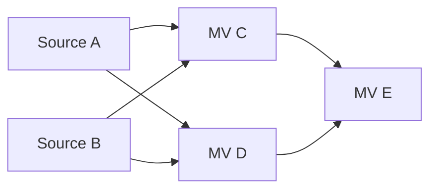

# 物化视图日志连续性与 OOP 刷新设计

**状态：设计确定，待实现**
**日期：2026-10-13**
**更新日期：2026-10-19**
**适用分支：`nested_mv`**

本设计支持已有自身 MLog 或下游 MV 的物化视图执行 `COMPLETE OUT OF PLACE`。
OOP 为目标 MV 创建新的输出 MLog，在同一 cutover 事务中发布新 MV、新 MLog 及其
依赖绑定。MLog 的物理 ID 标识一段连续的日志历史，每次替换使用全新且不复用的 ID。

下游保留上一次成功构建结果所对应的 MLog ID。OOP 后，下游仍可查询已有数据，
但 FAST 因日志身份变化而失败；下游通过 COMPLETE 重建数据及消费基线后恢复 FAST。
普通 COMPLETE 的基线恢复使用刷新数据事务，不增加 DDL 流程。

状态模型按 source 与 MV 的多对多关系设计。当前 SQL 仍只支持单 source，未来多 source
使用同一套完整日志集合与 MV 级统一水位协议。本次不支持普通表 TRUNCATE，也不放开
对 MV、MLog 内部存储对象的直接 TRUNCATE。

FAST 和 COMPLETE DELTA APPLY 保留现有 `for_update_ts` 数据读取路径。刷新按最终
成功执行尝试的实际读取快照检查 source / MLog 身份，consumer 不对上游 MLog info
行加锁。升级时只创建系统表，已有 MV 在 refresh 前 lazy 初始化，新建 MV 在创建时登记。

## 1 背景与设计边界

### 1.1 当前分支行为

[已交付的 nested MV 实施计划](mv_nested_implementation_plan_zh.md)记录了当前能力：

- ready MV 可以拥有 MLog，并作为另一 MV 的 source。
- FAST 和 COMPLETE DELTA APPLY 在同一事务中更新目标 MV 并写入其自身 MLog。
- 已有自身 MLog 的 MV 拒绝 COMPLETE IN PLACE；有自身 MLog 或 child 的 MV 拒绝 OOP。
- 依赖关系按对象 ID 保存，parent-first 刷新顺序由调用方保证。

当前 OOP 的 shadow table ID 会替换原 MV ID，但尚未处理其输出 MLog 和下游引用，
全量替换也没有产生供下游消费的完整 delta。
[cutover worker](../../../pkg/ddl/table.go)的入口为
`onRefreshMaterializedViewCompleteOutOfPlaceCutover`。

本文定义这项扩展的目标行为；当前实施计划继续描述已实现的能力。

### 1.2 本次范围

1. 支持受控 MV 写入下的 parent OOP、下游 FAST 失效及 COMPLETE 恢复。
2. 表达多个 source、多个 consumer，以及同时作为 consumer 和 source 的中间层 MV。
3. 在 cutover 中原子迁移结构依赖、替换输出 MLog 并迁移目标自身的消费基线。
4. 将日志保留、刷新提交、initial build、drop、rollback 和升级纳入同一协议。
5. 保持现有 SQL 语法；FAST 失效时明确报错，由用户选择执行 COMPLETE。

本次不实现多 source SQL、join 增量算法、自动级联、依赖图调度或严格的传递 freshness
保证。COMPLETE IN PLACE 在带自身 MLog 的 MV 上保持现有限制。
普通表 TRUNCATE 与持续一段时间的非 MLog 写入操作属于第 13 节的后续扩展。

### 1.3 MV 写入串行与对象交接

同一 MV 的写入由系统控制并串行执行。parent OOP 持有目标 MV 的维护排他权，
等待已有 refresh 数据事务结束，再进行 build 和 cutover。shadow build 只写受保护的
shadow，不向 serving MV 的输出 MLog 追加数据。

切回前，针对旧 MV 的 refresh 及其 MLog 写入均已结束；切回后的写者重新解析
新 MV 与新 MLog 的绑定。维护排他权和 schema 发布要覆盖物理 MV ID 的交接，
针对旧 ID 的请求必须失败或重新解析，不能写入已退役的对象。

以 `t -> mv1 -> mv2` 为例，对 mv1 执行 OOP 时，替换的是 mv1 与它的输出
`MLog(mv1)`。上游 t 的 DML 和 `MLog(t)` 写入可以继续；shadow 的读取快照之后
发生的 t 变化，仍由 mv1 后续 FAST 消费。

## 2 OceanBase 参考与 TiDB 对象模型

参考版本为 OceanBase `v4.4.2_CE_BP2`，commit
`e9fc1e5f01f0cf7cc3a801af6c2c05c34d491d77`。

OceanBase 在 `__all_mview_dep` 的依赖记录中保存
`IS_COMPLETE_REFRESH_ONLY_FLAG`。切换时替换依赖的容器表 ID 并置位，FAST 检查该标记，
COMPLETE 成功时重建目标 MV 自己的依赖记录，使其再次支持 FAST。
[标记定义](https://github.com/oceanbase/oceanbase/blob/e9fc1e5f01f0cf7cc3a801af6c2c05c34d491d77/src/sql/resolver/mv/ob_mv_dep_utils.h#L37)、
[切换时置位](https://github.com/oceanbase/oceanbase/blob/e9fc1e5f01f0cf7cc3a801af6c2c05c34d491d77/src/sql/resolver/mv/ob_mv_dep_utils.cpp#L604)、
[FAST 检查](https://github.com/oceanbase/oceanbase/blob/e9fc1e5f01f0cf7cc3a801af6c2c05c34d491d77/src/sql/resolver/mv/ob_mv_provider.cpp#L427)、
[依赖重建](https://github.com/oceanbase/oceanbase/blob/e9fc1e5f01f0cf7cc3a801af6c2c05c34d491d77/src/rootserver/mview/ob_mview_dependency_service.cpp#L197)

OceanBase 保留逻辑 MV ID，切换它的 `data_table_id`，并为新容器重建 MLog。
容器、依赖和刷新信息在同一个 DDL 事务中切换；切换前检查构建依赖的 schema version。
[OOP 实现](https://github.com/oceanbase/oceanbase/blob/e9fc1e5f01f0cf7cc3a801af6c2c05c34d491d77/src/rootserver/ob_ddl_service.cpp#L23856)

TiDB 的 MV ID 就是物理 table ID，OOP 会同时替换 MV ID 和输出 MLog ID。
结构引用由 `TableInfo` 维护，每个 consumer 已确认的输入日志身份由运行系统表维护。
各 consumer 可以独立执行 COMPLETE 恢复，普通 COMPLETE DELTA APPLY 通过数据事务
更新自己的日志基线及统一水位。

## 3 多对多模型与核心不变量



source 指普通物理表或 ready MV。边 `S -> M` 表示 M 的定义直接读取 S。
每个 MV 登记完整的输入 MLog ID 集合；任一 source 缺少 MLog 时，额外登记一个无日志
占位。同一 source 当前至多拥有一个 MLog，MLog 也只有一个 owner。
同一 source 在 SQL 中出现多次，不按 SQL alias 重复建立消费记录。

本设计采用以下不变量：

1. `TableInfo` 是结构依赖的权威定义；运行记录不能单独建立或删除结构依赖。
2. MLog ID 标识日志物理实例。OOP 原子发布新的 MV / MLog 对，并停止向旧输出日志写入。
3. FAST 要求实际计划读取、已登记基线和数据快照上的 source / MLog 绑定一致。
4. FAST 要求完整日志集合一致、所有 source 都有 MLog，并通过日志保留及 purge
   完整性检查。全部 source 共用一个 MV 级成功水位。
5. 一次成功刷新原子提交目标数据、自身输出 MLog、完整消费基线及统一水位和成功信息。
6. COMPLETE 根据实际计算快照建立消费基线；所有 COMPLETE 都检查 source 物理身份，
   包括未来明确只做 COMPLETE 的 MV。
7. parent OOP 保留下游已确认的日志 ID 和成功水位。下游成功 COMPLETE 后才更新其基线。
8. 每个新建 MV 在注册结构依赖时登记输入日志。升级遗留 MV 按第 11 节初始化。
   整组基线替换原子提交，旧输出 MLog 的回收保留下游持有的旧身份记录。
9. 目标维护排他权保证同一 MV 写入串行。consumer 按实际快照校验上游身份；
   对象引用与运行记录仍受正常 DDL、schema 和事务冲突检查保护。

### 3.1 有效性判定

对一条结构边 `S -> M`，设普通 FAST 实际计算快照为 `U`，定义：

```text
At(S, U) = (source_id, mlog_id) @ schema U
Used(M, S) = 本次计划实际读取的 source / MLog 物理身份
W(M) = mysql.tidb_mview_refresh_info.LAST_SUCCESS_READ_TSO
RequiredLogs(M, U) = M 在 schema@U 上全部结构 source 对应的正 MLog ID 集合
RegisteredLogs(M) = M 在消费基线表中登记的正 MLog ID 集合，不含 0 占位
HasNoMLogPlaceholder(M) = M 存在 MLOG_ID = 0 的记录

Valid(M, S, U) =
    Used(M, S) 与 At(S, U) 的 source / MLog 绑定一致，且 owner 反向绑定合法
    AND 键 (M, At(S, U).mlog_id) 存在
    AND 日志保留与 purge 完整性检查通过

CanFast(M, U) = M 的定义允许 FAST
    AND W(M) 非 NULL
    AND schema@U 上全部 source 都有 MLog
    AND NOT HasNoMLogPlaceholder(M)
    AND RequiredLogs(M, U) == RegisteredLogs(M)
    AND 对所有结构入边 S -> M，Valid(M, S, U) 均成立
```

日志身份匹配仍需配合 purge 完整性检查，确保从 `W(M)` 开始的增量没有被删除。
`At(S, U)` 使用实际数据快照上的状态。source 在 `U` 之后切换时，本次只能确认
旧身份；能否提交仍受正常冲突检查约束。该结果提交后，下次 FAST 会发现基线失效。
`CanFast` 不表示全部祖先已经最新，parent-first 刷新顺序仍由调用方保证。

### 3.2 状态由记录与水位推导

| 状态 | 判定 | 处理 |
| --- | --- | --- |
| 待初始化 | 升级遗留、整组日志记录缺失，且满足第 11 节的普通表 source 条件 | refresh 前 lazy 初始化 |
| 未完成首次构建 | MV 级成功水位为 NULL | initial build 或 COMPLETE |
| 缺少 source MLog | 存在 0 占位，或快照上的 source 缺少 MLog | COMPLETE；建齐日志并建立完整基线后可 FAST |
| 有效 | 完整日志集合、实际绑定、成功水位与日志保留检查均通过 | FAST 或 COMPLETE |
| 需要 COMPLETE | 日志 ID 集合不匹配，或消费区间存在日志缺口 | COMPLETE 重建数据及整组基线 |
| 元数据不一致 | 不符合 lazy 前提的整组登记缺失、结构绑定非法、owner 不匹配或必需运行记录损坏 | 报一致性错误 |

MLog 换 ID 后，基线保留旧日志 ID、缺少当前日志 ID，是预期的失效状态。
缺少某条记录、多出旧记录或存在 0 占位，都不能通过填入当前 ID 的方式修复。
成功 COMPLETE 根据实际数据快照原子替换完整集合。

## 4 持久化布局

本机制新增一张系统表。以下定义为待实现的目标 schema。

### 4.1 TableInfo 保存结构依赖

现有字段表达 source、consumer 与 MLog 的正反向关系：

- consumer 的 `MaterializedView.BaseTableIDs`。
- source 的 `MaterializedViewBase.MViewIDs`。
- source 的 `MaterializedViewBase.MLogID`。
- MLog 的 `MaterializedViewLog.BaseTableID`。
- MLog 的 `MaterializedViewLog.DependentMViewIDs`。

定义见 [model/table.go](../../../pkg/meta/model/table.go)，注册入口见
[create_table.go](../../../pkg/ddl/create_table.go)的
`updateMaterializedViewBaseInfoOnCreate`。source 与日志的当前绑定从对应快照的
结构元数据解析，consumer 的已确认日志集合保存到第 4.2 节的系统表。

### 4.2 FAST 日志消费基线表

```sql
CREATE TABLE mysql.tidb_mview_fast_refresh_source_info (
    MVIEW_ID BIGINT NOT NULL,
    MLOG_ID BIGINT NOT NULL,
    PRIMARY KEY (MVIEW_ID, MLOG_ID),
    KEY idx_mlog (MLOG_ID, MVIEW_ID)
);
```

主键支持读取一个 MV 的全部日志基线；反向索引支持按 MLog 查找已登记的消费记录。
结构 consumer 集合从 `TableInfo` 枚举，因为下游持有的旧日志 ID 可能与当前绑定不同。

| MLOG_ID | 含义 |
| --- | --- |
| `0` | 登记的 source 中至少一个没有 MLog |
| 正 ID | 该 MV 登记的一个输入日志身份，结合成功水位判断其基线 |

联合主键列不能为 NULL，因此以 0 表示无日志占位。一个 MV 至多有一条占位；
未来多 source 时，正 ID 与占位可以并存。占位表示日志集合不完整，具体缺少日志的
source 仍从结构元数据解析。占位不对应真实 MLog，也不单独参与 purge 水位计算。

initial build 前登记已知日志 ID，MV 级水位为 NULL；构建成功时与数据一起确认完整
日志集合及水位。已有成功水位的 MV，其记录表示上次成功构建对应的输入身份。
补建日志后，由成功 COMPLETE 更新整组记录并清除占位。

source OOP 时，下游的旧日志记录和统一水位保持不变。consumer 自己 OOP 时，
其记录的 `MVIEW_ID` 随目标身份迁移，输入日志集合来自 shadow build 的实际快照。
普通 FAST 保留原日志集合，只推进统一水位。

source ID 由实际计划和快照上的结构绑定校验；统一成功水位保存在现有 refresh-info。
因此本表仅保存两个 ID，全部 source 共同推进消费进度。

所有新建 MV 都登记记录。未来明确只做 COMPLETE 的 MV 也登记真实日志或占位，
其配置决定是否保留 FAST 能力。0 只表示缺少日志；正 ID 集合也不能单独证明允许 FAST。
本次 SQL 仍只支持 FAST 定义，COMPLETE-only 与刷新方式切换属于未来能力。

### 4.3 MLog 的 purge 运行状态

`mysql.tidb_mlog_purge_info` 保持现有 schema：

```text
MLOG_ID
NEXT_PURGE_UNIX_SECONDS
LAST_PURGED_TSO
```

新输出 MLog 在 cutover 事务内按新建日志的约定初始化独立运行记录，
保留原日志定义中的 purge 配置。旧日志运行记录随旧对象退出调度并清理，
purge history 按既有保留规则处理。

`LAST_PURGED_TSO` 表示对应物理日志实际删除的边界。各 MLog ID 的删除水位及 hazardous
purge history 独立解释，切回不清零仍存续日志的删除水位。定义见
[bootstrap.go](../../../pkg/session/bootstrap.go)。

### 4.4 refresh-info 保存统一水位

`mysql.tidb_mview_refresh_info` 继续承担目标刷新行锁、调度、成功时间与统一水位。
`LAST_SUCCESS_READ_TSO` 是该 MV 全部 source 共用的成功逻辑水位：
普通刷新使用最终实际计算 TS，bounded FAST 沿用指定成功上界。

目标数据、输出 MLog、输入日志集合及成功水位在同一刷新事务提交。
普通 COMPLETE DELTA APPLY 使用数据事务恢复基线；OOP 在原有 cutover DDL 事务中
发布目标和运行记录。输入日志失效的 consumer 仍按其旧成功水位保护各 source 当前的 MLog。

## 5 OOP 替换 MV 与输出 MLog

### 5.1 新 MLog 作为 OOP 的配套对象

目标 MV 有输出 MLog 时，为 cutover 分配一个全新 MLog ID，并将新旧日志 ID
纳入持久化 job 参数。重试复用同一组已分配身份。

新日志按既有 MLog 建表规则生成定义，承接原日志的 tracked columns、索引定义、
purge 配置和告警配置，owner 指向新 MV，consumer 集合来自实际结构依赖。
cutover 事务创建新日志元数据和 purge-info 记录，并原子发布绑定。
该配套日志纳入同一个 OOP job 的创建、回滚和恢复流程。

新日志初始为空。shadow build 已经生成目标完整结果，切回不为这些行补写全量
I/U/D；新日志只记录切回后对新 MV 执行刷新产生的变化。
没有输出 MLog 的目标沿用既有 OOP 路径，并维护其自身的输入日志基线。

### 5.2 切换时序

设：

- `R_build`：shadow build 实际读取上游数据的 TSO。
- `C`：cutover commit TSO，用于描述原子发布时序。
- `(M_old, L_old)`：旧 MV 与旧输出 MLog。
- `(M_new, L_new)`：新 MV 与新输出 MLog。

```text
C 之前：serving MV = M_old，输出日志 = L_old
C 提交：原子切换为 M_new / L_new，更新全部结构引用及目标运行记录
C 之后：新刷新写 M_new，并将实际 I/U/D 写入 L_new
```

目标维护排他权保证旧 MV 写事务已结束，新 MV 写者在身份交接后才进入。
因此新输出日志只有新 MV 的后续变化，旧日志记录留在旧物理实例中。
上游 source 继续正常写入，目标自身的输入水位来自 `R_build`。

下游仍登记 `L_old`。读取切回后 source 的 FAST 会发现当前绑定是 `L_new`，
要求执行 COMPLETE。COMPLETE 按实际读取快照取得新 source 数据及 `L_new`，
成功时连同目标结果、水位一起替换基线。

`R_build` 描述目标作为 consumer 已读取的上游进度；`C` 描述它作为 source
发布新物理对象的时点。这两个时间服务于不同方向的依赖关系。

### 5.3 刷新模式与输出日志

| 目标 MV 的刷新方式 | 自己的输入基线 | 自身输出 MLog |
| --- | --- | --- |
| FAST | 保留日志身份，推进统一水位 | 向原日志写入完整 I/U/D |
| COMPLETE DELTA APPLY | 按完整重算的实际快照替换基线 | 向原日志写入实际差异，日志保持连续 |
| COMPLETE OUT OF PLACE | 按 shadow build 快照建立基线 | 原子发布新日志 ID，初始为空 |
| COMPLETE IN PLACE | 无输出 MLog 时按实际读取快照确认基线 | 带自身 MLog 时保持现有限制 |

OOP 的最终行集即使与旧 MV 相同，仍发布新输出 MLog，直接下游的旧基线仍失效。
DELTA APPLY 沿用该模式已有的 SQL 与 schema 限制。

### 5.4 旧对象回收

cutover 后，旧 MV 与旧输出 MLog 一起纳入 OOP 的 delete-range / GC 流程。
物理回收遵守正常的 DDL、在途事务、历史快照和 GC 安全条件。

下游完成 COMPLETE 不是旧日志物理回收的前置条件。旧身份对新快照上的 FAST 已经
无效，下游恢复读取新 source 的完整数据，不需要依赖旧日志数据。
仍在旧快照上执行的合法读取受正常对象及存储生命周期机制保护。

下游基线表中的 `L_old` 记录继续保留到该 MV 成功 COMPLETE 或自身被 DROP。
旧 MLog 的 GC 不删除这些消费记录。记录可以引用已经退役的日志 ID，用于表明
现有结果依赖的旧输入身份。

## 6 刷新协议

### 6.1 实际读取 TS 与历史 schema

普通 FAST 和 COMPLETE DELTA APPLY 保留 `for_update_ts` 读取，以最终成功执行
尝试实际使用的 TS 为 `U`。MLog 聚合、旧 MV 值和普通 MIN/MAX 回查等计算读取
对应同一 `U`；写锁继续使用正常的悲观事务机制。

数据语句完成后立即保存 `U` 和计划实际使用的 source / MLog ID。
后续更新基线或成功信息的 SQL 可能推进 `for_update_ts`，成功水位仍使用保存的
计算 TS。悲观锁重试时，失败尝试的修改先撤销，只检查最终成功执行尝试。

普通事务的编译 schema 与数据读取 TS 不自动对应：编译使用事务 InfoSchema，
MDL 预处理还可能按名称取得较新的表定义。本机制保留正常编译流程，
在数据语句执行后取得 `schema@U`，核对本次实际使用的物理身份。

`schema@U` 通过 [domain.go](../../../pkg/domain/domain.go)的
`GetSnapshotInfoSchema(U)` 取得，解析全部 source、所属 schema、MLog ID 及 owner
反向绑定。该检查使用历史结构元数据，consumer 无需锁定上游 purge-info 行。
历史 schema 不可用或绑定无法确认时，原刷新事务回滚。

FAST 对每个 source 验证：

```text
已确认基线中的 MLog ID
    == 本次计划实际读取的 MLog ID
    == schema@U 中对应 source 绑定的 MLog ID

本次计划实际使用的 source ID
    == schema@U 中对应 source 的 ID
```

编译时可以先检查基线与实际计划，执行后的历史绑定检查负责覆盖编译至最终 `U`
之间的对象切换。校验同时验证完整 source / MLog 集合及 owner，不能仅比较日志名称，
也不能在执行结束后静默换成另一张表。

所有 COMPLETE 都校验实际 source ID 与其计算快照上的身份，包括未来明确只做
COMPLETE 的 MV。需要建立 FAST 基线时，捕获同一快照上的完整日志集合。
全量重算仍可能读到旧物理 source，因此需要这项身份检查。

OOP 对 shadow build 使用同样规则，实际快照为 `R_build`。
build 的实际 source / MLog 身份、完整日志集合与读取 TS 传给 cutover job，
worker 始终确认 build 所读取的身份。

### 6.2 FAST

升级遗留 MV 先完成第 11 节的前置初始化，然后进入刷新主体：

1. 取得目标 MV 维护排他权，再开始数据事务并取得现有 refresh-info 行锁。
2. 重新解析目标及全部 source，读取输入日志基线与统一水位，检查完整集合。
3. 编译时检查实际读取的 MLog ID 与基线一致，执行现有日志保留和 purge 完整性检查。
4. 按现有 `for_update_ts` 路径计算，暂存目标数据及自身 MLog 的写入。
5. 立即保存最终 `U`，按第 6.1 节核对 `schema@U` 上的全部物理绑定。
6. 校验成功后在原数据事务中提交数据、输出日志及成功信息，统一水位推进到保存的 `U`。
   日志 ID 集合保持不变；任一步失败全部回滚。

日志基线与快照上的 ID 不匹配时，返回要求 COMPLETE 的错误。
实际计划与快照绑定不一致时回滚，允许重新编译执行；重新执行仍须通过基线检查。

无数据语句的 FAST no-op 显式选取验证快照，完成身份检查后返回，成功水位保持不变。
`FAST AS OF TIMESTAMP` 保留现有区间和指定成功上界语义：日志扫描 TS 与指定上界
分别保存，历史 MIN/MAX 使用指定上界及其 schema。各条读取按自身实际快照核对
身份并与基线保持一致，历史上界不能绕过实际扫描时已经发生的日志替换。
本设计不改变 bounded FAST 的既有计算算法。

### 6.3 COMPLETE DELTA APPLY 与普通 COMPLETE

COMPLETE 可以从失效基线开始。它读取完整 source 重新计算结果，
DELTA APPLY 使用最终成功尝试的 `U` 检查实际 source 身份，并取得输入日志集合。
新集合无需等于旧基线，只需与实际构建结果的读取快照一致。

在同一数据事务中提交：

- 目标 MV 数据。
- DELTA APPLY 向目标自身 MLog 写入的实际行级差异。
- 实际快照上的完整输入日志集合，包括适用的 0 占位。
- 统一成功水位、成功时间与调度信息。

整组基线原子替换，清理旧日志键；任一步失败保留原结果、基线及水位。
COMPLETE IN PLACE 在允许的目标上保持既有读取行为，按实际 TS 检查 source 并确认基线。

未来明确只做 COMPLETE 的 MV 同样登记输入日志或占位，校验 source 物理身份，
但其配置不要求有效 FAST 基线，也不按消费进度阻塞 purge。
未来启用 FAST 时执行第 10.5 节的保护和确认流程。

一次 COMPLETE 只恢复目标自身的输入基线。同一 source 的其他 consumer 保持原状态。
中间层通过 DELTA APPLY 恢复时，输出 MLog 连续，其下游基线继续有效。

### 6.4 OOP build 与 cutover

build 阶段保持 shadow 受保护；child 可以刷新旧 serving MV，
由后续实际快照校验处理与切回的并发。

cutover 在目标维护排他权仍有效的条件下，检查对象 revision、输入水位、
输出日志身份、依赖集合及实际 DDL 写集合，执行第 8 节的原子迁移。
输入基线使用 build 实际确认的日志集合，输出绑定发布新 MLog。

child 的日志记录和成功水位由其自身 refresh 维护，parent cutover 保留这些记录。
新建 child 已在创建流程登记，升级历史对象的初始化见第 11 节。

cutover 事务失败时，旧 serving MV、旧输出日志、依赖与运行记录一起保留。
shadow 的清理沿用既有 OOP 流程；配套新日志元数据与运行记录随事务回滚。

## 7 并发协议与事务排序

### 7.1 快照校验与提交

source 可以在数据计算前后执行 OOP。consumer 需要证明计算绑定与实际读取快照
一致，不要求把上游对象固定到自己提交。

```text
U：FAST 读取旧 source / L_old，基线匹配 schema@U
C：parent OOP 发布新 source / L_new
R：FAST 按 schema@U 校验后，尝试提交结果及水位 U
```

若正常对象、schema 与事务冲突检查允许提交，该结果仍对应 `U`，保留旧日志基线。
下次 FAST 发现当前是 `L_new`，要求 COMPLETE。若正常冲突检查要求回滚，则整体回滚。

若 `C <= U`，旧计划仍读取 `L_old`，则实际绑定与 `schema@U` 不同，检查失败；
计划已读取 `L_new` 时，也会因原基线仍是 `L_old` 而失败。
数据语句之后进行一次最终快照检查即可覆盖这些情况。

目标维护排他权、refresh-info 行锁、基线替换或迁移的事务检查继续有效。
consumer 的身份校验只读取历史 schema，多个 consumer 可并发校验同一上游。

### 7.2 多 source 与恢复竞争

```text
C COMPLETE 按 U 重算，实际读取 A / LA1、B / LB1
B 在 U 之后 OOP，发布新 B / LB2
C 按 schema@U 校验，尝试提交完整 {LA1, LB1} 及水位 U
```

C 提交成功时，结果和全部基线都对应 `U`，其中 B 的旧基线在切回后失效。
若 B 在 `U` 之前切回，C 只有实际读取新 B，并与数据一起登记 `LB2`，才可成功恢复。
读取旧物理 B 的计划必须失败。

完整日志集合与统一水位一起提交。一个 source 的成功不能单独推进整个 MV，
也不能把未实际读取的新日志 ID 混入基线。

### 7.3 多 consumer 独立恢复

```text
A OOP：LA1 -> LA2
C COMPLETE：确认自己的输入日志 LA2
D 尚未 COMPLETE：仍登记 LA1
```

C 可以 FAST，D 要求 COMPLETE。两个 consumer 各自维护自己的基线和水位，
上游切回及 C 的恢复都保留 D 的记录。

### 7.4 多个 parent 同时 OOP

A、B 同时作为 C、D 的 source 时，两个 parent 分别替换自己的输出日志。
共享 child 的 `MaterializedView.BaseTableIDs` 会被两个 cutover 修改，需要 DDL 涉及对象的
排他调度及 worker 重读，避免旧副本覆盖另一条 source ID 更新。

cutover 的 `InvolvingSchemaInfo` 覆盖全部实际修改的上游 source、上游 MLog、
目标、shadow、旧新输出 MLog 和直接 consumer。
build 期间新增 MLog、增删 child 或依赖变化导致实际写集合超出调度范围时，
本次 cutover 失败并重新规划。

### 7.5 目标身份迁移与 schema cache

consumer 自己 OOP 后，其 `MVIEW_ID` 改变。针对旧目标的刷新通过维护互斥、
目标身份检查、条件更新及事务冲突检查退出，防止重新创建旧目标的运行记录。
刷新主体在取得维护锁后重新确认目标，前置 lazy 初始化的缓存不作为最终依据。

跨节点 schema cache 尚未收敛时，实际 source / MLog 身份可能与 `schema@U` 不同。
此时返回可重试错误，重新解析和执行；快照上的 owner 反向绑定也必须一致。
旧 MV 锁的释放、新 ID 写入口和 schema 同步共同维持第 1.3 节的写入串行保证。

### 7.6 事务重试与崩溃

悲观数据语句重试可能推进 `for_update_ts` 并重建 executor。
只保留最终成功尝试的计算结果与 `U`；后续元数据更新推进锁 TS 时，
已保存的计算水位保持不变。

cutover 重试重新读取结构、revision、期望旧日志及运行记录，校验完整写集合。
配套新 MLog 使用 job 已分配的 ID，输入基线保持 build 捕获值。
上游在 `R_build` 之后切换，本身不会让 build 结果变成另一个快照；
若当前对象引用或 revision 已不允许迁移旧结果，则回滚并重新构建。

commit 之前崩溃：新日志元数据、运行记录与全部迁移一起回滚，恢复后继续处理旧对象。
commit 之后崩溃：新 MV / MLog 已经 serving，恢复任务依据持久化 job、对象 ID
和 schema 判断切回已完成，继续旧对象 GC 与任务收尾。历史记录仍为 running
不能作为再次分配日志、重复切回或删除新日志的依据。

## 8 Cutover 的完整迁移集合

设目标由 `M_old` 切换为 `M_new`，输出 MLog 由 `L_old` 切换为 `L_new`。
以下变更属于同一个 DDL 事务：

| 对象 | 变更 |
| --- | --- |
| serving MV | 使用新 ID 承接名称、定义、ready 状态及完整 source ID 集合 |
| 全部上游 source | `MaterializedViewBase.MViewIDs` 中将 `M_old` 替换为 `M_new` |
| 全部上游 MLog | `DependentMViewIDs` 中将 `M_old` 替换为 `M_new` |
| 新 MV 的 `MaterializedViewBase` | 保存 `L_new` 与原有直接 child ID 集合 |
| 新输出 MLog | 发布新 `TableInfo`，owner 为 `M_new`，保留日志定义和实际 consumer 集合 |
| 旧输出 MLog | 从当前 schema 退役，物理数据交给旧对象 GC |
| 输出日志运行记录 | 初始化 `L_new` 的 purge-info，旧日志退出活动调度 |
| 全部直接 child | `BaseTableIDs` 中将 `M_old` 替换为 `M_new`，保留其他 source |
| 目标输入基线 | 删除旧目标键，以 `M_new` 和 build 捕获的完整日志集合登记 |
| child 消费基线 | 保留原日志 ID 与统一水位 |
| 整体 refresh-info | 迁移目标 ID，以 `R_build` 更新成功水位、时间及 schedule |
| schema diff | 发布旧新 MV、旧新输出 MLog 和全部被修改的依赖对象 |

输出日志名称随目标的正式名称承接，所有依赖引用使用物理 ID。
对象可能属于不同 schema，迁移时逐个解析所属 schema。
新目标只登记 build 确认的输入日志集合，目标旧 ID 的运行记录一并移除。
迁移冲突或新 ID 下已有非法记录时，整个切回事务回滚。

[现有 job 参数](../../../pkg/meta/model/job_args.go)需要携带配套日志的旧新 ID、
build 确认的输入身份以及恢复所需的期望值。
[schema_version.go](../../../pkg/ddl/schema_version.go)与
[infoschema/builder.go](../../../pkg/infoschema/builder.go)的 apply 路径覆盖全部 affected objects。
[delete_range.go](../../../pkg/ddl/delete_range.go)将旧输出 MLog 纳入原有 OOP 回收对象集合。

运行记录写入沿用 [table.go](../../../pkg/ddl/table.go)中
`migrateMViewRefreshInfoForOutOfPlaceCutover` 的原则：通过 table API 写入同一个
DDL 事务，保证任何迁移失败都回滚全部状态。联合主键的 handle 按新表实际 schema
构造。新 MLog 的创建和 purge-info 初始化也遵守同一原子性要求。

## 9 日志保留与 Purge

### 9.1 按统一成功水位保护当前日志

当前 `calcMaterializedViewLogSafePurgeTSO` 从 refresh-info 取得多个 MV 的最小水位，
见 [materialized_view.go](../../../pkg/executor/materialized_view.go)。

purge 从当前 source 的结构依赖与 building DDL job 枚举全部需要保留 FAST 能力的
consumer，再取得其统一成功水位。直接查询新 MLog ID 下的消费记录会漏掉尚未
COMPLETE 的下游，因此消费基线表的反向索引不作为 consumer 集合的唯一来源。

```text
W(M) 非 NULL：保护水位 = W(M)
W(M) 为 NULL：保护水位 = 0
safe_purge_tso = min(purge transaction startTS, 所有保护水位)
没有 FAST consumer / building consumer 时，沿用事务 startTS 上界
```

日志身份失效、存在 0 占位、缺少当前日志记录，以及升级遗留尚未 lazy 初始化，
都不取消结构 consumer 的保护。明确只做 COMPLETE 的 MV 不参与消费水位保护；
正在启用 FAST 的对象按第 10.5 节建立持久保护。

OOP 后，`L_new` 按所有直接 consumer 的既有 `W(M)` 计算保留范围，
即使这些 consumer 还登记 `L_old`。这保证 COMPLETE 选取快照之后的变化持续保留；
COMPLETE 成功后才原子更新基线和水位。

第一版接受失效 consumer 长时间不恢复导致新日志持续保留的成本。
旧日志实例按第 5.4 节回收，其物理回收不等待这些 consumer 的水位推进。

### 9.2 Initial build 与 COMPLETE 保护

initial build 在选择数据快照之前注册输入日志与结构依赖，
并沿用 building DDL job 的日志保护。整体成功水位尚为 NULL 时按 0 保护。
构建成功后一起提交结果、完整日志集合与统一水位。

COMPLETE 从有效或失效状态恢复时，旧的持久化成功水位始终保护构建期间的当前日志。
刷新失败保留原保护，成功提交后再采用新水位。基线替换的中间状态不对 purge 可见。

源自升级的普通表 MV 即使尚未登记新表，也继续按已有 refresh-info 保护日志。
缺少必需的 refresh-info、结构依赖损坏或 owner 绑定非法时，purge 停止并报错；
不能通过忽略对应 consumer 来提高删除上界。

### 9.3 Purge 与物理日志替换并发

purge run 始终绑定具体的 MLog ID，沿用现有 purge-info 行锁、删除水位和 history 协议。
parent OOP 原子退役旧日志并发布新日志，旧任务不能按相同日志名称转而处理新 ID，
也不能将旧 source 的 consumer 集合套用于新日志。

cutover 与旧 purge 状态写入的竞争按正常事务冲突和一致锁序处理。
旧任务发现对象已退役时停止活动 purge，由旧对象回收流程继续清理；
收尾更新须检查对象身份和影响行数，避免重新创建已退役日志的运行记录。

新日志拥有独立的 purge-info。旧日志的 `LAST_PURGED_TSO` 和 running / failed history
按旧 ID 解释；当前仍存续日志的删除水位、cutoff 单调性和 hazardous history 检查继续生效。
consumer 的历史 schema 校验不获取上游 purge-info 行锁。
在途读取及旧物理数据的存储安全由正常 DDL / snapshot / GC 机制保证。

## 10 生命周期与用户行为

### 10.1 CREATE 与 initial build

每个新建 MV 在注册结构依赖的同一个 DDL 事务中，按当前完整输入日志集合登记记录。
任一 source 缺少 MLog 时，额外登记一个 0 占位。该登记与 source、MLog 的正反向
依赖一起生效，所有新建 nested MV 都满足这一要求。

initial build 校验实际 source 身份，成功时原子提交完整基线与统一水位。
source 在 build 期间 OOP 时，按实际计算快照检查；计划仍绑定旧物理对象而读取 TS
已越过切回时点，就回滚重试。读取快照之后的切换按第 7 节处理。

create rollback / cancel 清理本 MV 的全部运行记录、占位及结构反向引用。
未来 COMPLETE-only 对象同样登记，缺少日志时可以通过全量构建建立数据，
其 FAST 能力由配置与后续基线建立流程决定。

### 10.2 DROP 与日志对象清理

DROP MV 删除自己的输入基线和运行记录；作为 source 时按现有依赖保护拒绝非法 DROP。
DROP MLog 保持已有 dependent MV 限制。普通表 TRUNCATE 与任意日志重建 SQL
保持本次范围以外的限制。

OOP 退役的旧输出 MLog 与仍保留的下游基线是不同生命周期：
删除日志物理数据或清理其 purge-info 时，保留下游的旧 MLog ID 记录。

DROP DATABASE 清理该 schema 内被删除对象的运行记录，并遵守跨 schema 依赖限制。
consumer 自己被删除或成功重建基线时，才清理其对应的旧日志消费记录。

### 10.3 错误和恢复

错误区分以下原因，并标识相关 MV、source、读取 TS 和日志 ID：

- 基线日志 ID 与实际快照不同：目标需要 COMPLETE。
- 日志保留范围已经越过成功水位，或存在 hazardous purge：目标需要 COMPLETE。
- 实际计划与读取快照上的物理绑定不同：本次回滚，可以重新编译执行。
- 目标迁移、schema 或事务冲突：按既有重试和失败规则处理。
- 结构、owner 或必需运行记录损坏：报告元数据一致性错误。

具体错误码与文案在实现中按现有规范确定。
source 在读取快照之后切换本身不构成错误，提交仍受正常对象及事务冲突检查约束。
日志基线失效的 MV 仍保持 ready、已有结果可查询。
自动调度的 FAST 同样明确失败并沿用现有观测流程，恢复由用户选择 COMPLETE。

### 10.4 三级关系的恢复

```text
A OOP -> C 的输入日志基线失效
C COMPLETE DELTA APPLY -> C 的输入恢复，输出 MLog 连续，E 的输入不因此失效
C COMPLETE OUT OF PLACE -> C 的输入恢复，输出换为新 MLog，E 的输入失效
```

日志身份变化影响对应的直接消费关系。A OOP 不会立即更换整个后代图的日志 ID。
E 同时依赖 C、D 时，完整输入集合都有效才允许 FAST；
这个条件仍不表示 C、D 的全部祖先已经刷新到最新。

### 10.5 未来从 COMPLETE 切换到 FAST

刷新方式配置由 MV 定义维护，消费记录登记实际输入日志。
切换到 FAST 时，需要已有数据与日志集合、水位及保留范围共同构成有效基线。

建立基线的流程为：

1. 在目标维护互斥下，确认全部 source 都有合法 MLog，缺少时按正常 DDL 创建。
2. 选择 COMPLETE 数据快照之前建立可恢复的持久日志保护，使 purge 将该对象作为
   building FAST consumer 处理；未来切换 DDL job 可以承载这项保护。
3. COMPLETE 按实际快照重建结果并捕获完整日志集合，在同一数据事务提交
   数据、统一水位与基线，清理占位及旧日志键。
4. 基线就绪后发布允许 FAST 的配置。持久保护覆盖基线提交到配置生效的窗口，
   随后交接为正常 FAST consumer 保护。失败或崩溃按持久任务状态恢复或取消。

已有完整有效基线、保留范围满足要求时，可以在协调好 purge 保护后复用。
配置发布失败时，已提交的 COMPLETE 结果仍然有效，配置保持原状态。
本节定义未来能力的协议；普通 COMPLETE 建立基线仍使用刷新数据事务。

## 11 升级与初始化

### 11.1 发布前提与 bootstrap

nested MV 与本系统表在同一个发布版本引入，拆分开发 PR 期间不发布中间能力。
升级前的 MV 只依赖普通表；该版本禁止带 MLog 普通表 TRUNCATE，
存在 dependent MV 时也禁止 DROP MLog。因此这些已有 MV 的输入 MLog ID
在当前受支持操作下保持稳定。

bootstrap 和 upgrade 通过现有可重入建表流程创建
`mysql.tidb_mview_fast_refresh_source_info`。
已有 MV 的登记由 refresh 路径逐个完成，bootstrap 只负责系统表 schema。

### 11.2 已有 MV 在 refresh 前 lazy 初始化

初始化放在取得刷新维护锁和执行刷新主体之前，使用独立短事务：

1. 在同一个初始化快照 `S_init` 下检查目标整组记录，并解析该目标全部 source / MLog 绑定。
2. 已有记录时保持原集合；整组缺失且 source 满足上述普通表条件时，登记完整日志 ID 集合。
   source 缺少必需日志或绑定非法时，返回相应错误。
3. 整组插入原子提交。并发初始化出现唯一键冲突或写冲突时，回滚短事务并重新检查；
   不能跳过冲突后继续插入部分集合。
4. 初始化提交后，取得 MV 维护排他权，再开启真正的刷新数据事务并读取 refresh-info 行锁。
   刷新主体重新确认目标身份、基线与水位。

检查缺失、解析绑定和插入属于同一个初始化事务。事务模式按实现的并发控制方式选择，
必须保证冲突重试重新判断，不能把不同快照的日志身份混成一组。
并发目标 OOP 或 DROP 仍须遵守目标身份与 DDL 协调，防止为退役目标重新建立记录。

初始化登记已有结果依赖的日志身份，保留原 `LAST_SUCCESS_READ_TSO`。
成功水位为 NULL 时继续保持未完成首次构建状态。初始化不修改目标数据，
后续刷新失败也可以保留已提交的初始化记录。

只对符合前提的整组缺失执行 lazy 初始化。已有集合缺少当前日志或含有旧日志，
由正常 FAST / COMPLETE 协议处理，不能通过补入当前 ID 来修复。

### 11.3 新建 nested MV 的登记

新版本创建 MV 时，在结构依赖注册事务中直接登记全部日志记录。
因此发布前没有尚待回填的历史 nested MV，发布后每个新建 child 都已登记。

parent OOP 保留下游基线即可，切回事务只迁移结构依赖和目标自身运行记录。
nested MV 缺失整组登记属于元数据一致性错误，不能根据切回后的当前日志 ID
反推其已有数据对应的基线。

### 11.4 版本兼容边界

新增 nested 能力及配套 OOP 的使用以集群完成二进制升级为前提。
bootstrap 完成只表示系统表 schema 就绪，不能证明执行中的维护任务都具备新协议能力。
跨版本执行和降级遵守集群的版本兼容约束；已经使用新能力的对象不能交给忽略其
物理身份校验与基线维护协议的旧版本执行刷新。

## 12 实现与验收

### 12.1 实现边界

| 边界 | 涉及入口 | 验收结果 |
| --- | --- | --- |
| 系统表与身份解析 | bootstrap、消费基线 helper、snapshot InfoSchema | 两列运行表、完整日志集合与 source / owner 绑定校验 |
| 刷新数据事务 | executor refresh、成功状态持久化 | 保存最终读取 TS，数据、输出日志、输入基线和水位原子提交 |
| OOP 配套日志 | job args、cutover、schema diff、InfoSchema | 新日志创建、旧新身份原子发布、依赖迁移及崩溃恢复 |
| 物理回收 | delete-range、purge、旧任务收尾 | 旧日志安全 GC，下游旧身份继续保留 |
| 生命周期与升级 | CREATE、DROP、rollback、前置初始化 | 新建即登记，旧普通表 MV 按需初始化，building 日志保护持续有效 |

实际接口和 mutation 应符合现有事务边界，尤其检查最终读取 TS 的捕获、
历史 schema 解析、联合主键操作和 cutover staging 原子性。
[刷新说明](mv_refresh.md)、[purge 说明](mv_log_purge.md)和
[initial build 状态](mv_init_build_state.md)在实现交付时同步更新。

### 12.2 当前 SQL 的验收场景

- parent OOP 后旧新 MV / MLog ID、owner、正反依赖及 InfoSchema 一致。
- child FAST 明确要求 COMPLETE，child COMPLETE 成功后 FAST 恢复。
- 同一 parent 的两个 child 独立恢复，一个成功不改变另一个的旧基线。
- parent 多次 OOP 以及结果行集相同的 OOP，每次使用全新日志 ID。
- 切回前后 I/U/D 写入各自对应的日志，新日志初始为空。
- 中间层 DELTA APPLY 恢复输入而保持输出连续，OOP 则使直接下游失效。
- FAST no-op 与 bounded FAST 完成身份及 purge 完整性检查。
- OOP 在最终计算 TS 之前生效时，旧绑定校验失败，回滚目标与自身 MLog 修改。
- OOP 在计算 TS 之后生效时，检查对应历史身份；提交受正常冲突规则约束，
  即使提交也只保存旧快照基线。
- 悲观语句重试后只使用最终读取 TS，成功信息更新不覆盖保存的计算水位。
- COMPLETE 与 COMPLETE-only 机制路径都拒绝实际 source 与快照不一致的计划。
- COMPLETE 替换完整日志集合和水位，失败保留旧结果及原保护。
- 新 MLog purge 从结构关系识别仍持有旧 ID 的 consumer，按其已有水位保护；NULL 按 0。
- 旧日志在满足正常 GC 条件后可回收，下游旧基线仍在，后续 FAST 继续正确拒绝。
- 旧 purge 任务只处理旧日志，不能处理同名新日志或复活旧运行记录。
- 各迁移步骤注入失败，验证 schema、日志绑定、运行记录与水位保持全旧或全新。
- cutover commit 前后崩溃恢复使用固定 job 身份，不重复创建或删除 serving 新日志。
- 新建 MV、CREATE rollback、DROP MV / DATABASE 原子维护登记与结构关系。
- 升级只建表，未登记旧 MV 仍由原水位保护；首次 refresh 前初始化不推进水位。
- 并发首次 refresh 原子登记同一完整集合，冲突重试，刷新主体失败仍保留初始化。
- 目标 ID 迁移及并发 DROP 不造成旧目标运行记录复活。

### 12.3 多对多机制验收

机制层以 `A、B -> C、D -> E` 构造多个 source、日志 ID 与消费记录，
即使当前 SQL 尚不接受多 source，也验证同一套事务协议：

1. 完整基线和统一水位一起提交，任一身份校验失败则全部回滚。
2. A、B 同时 OOP，不丢失共享 child 的任一结构引用迁移。
3. C COMPLETE 期间 A 或 B 切回，分别覆盖切回发生在读取 TS 前后的情况。
4. C、D 对同一新日志独立恢复，保留对方的记录与水位。
5. C 的全部 source 共用 W(C)，D 可有不同 W(D)；基线失效不取消对应水位保护。
6. 任一日志被替换后，旧正 ID 集合无法作为新日志的有效基线。
7. 缺边、多余边、source 集合变化与并发 drop 无法被部分确认掩盖。
8. 正 ID 与单条 0 占位可以并存，缺少任一日志时拒绝 FAST。
9. COMPLETE 原子清理占位及旧日志键，不影响同一 source 的其他 consumer。
10. COMPLETE-only 路径登记日志但不按进度阻塞 purge，仍校验 source 物理身份；
    刷新方式由定义决定。
11. 未来 COMPLETE 到 FAST 的启用覆盖保护建立、基线提交、配置发布与失败恢复窗口。

并发测试在实际 TS 确定、数据构建、历史绑定校验和 cutover mutation 之间设置确定性暂停点。
断言同时包含结果行集、日志集合、水位、物理对象与结构引用。

## 13 后续扩展与实现约束

### 13.1 普通表 TRUNCATE

未来支持带 MLog 普通表 TRUNCATE 时，可以原子发布新 source / 新 MLog 对，
consumer 继续通过已确认日志 ID 检测断点。DDL 必须保证参与 consumer 的登记已完成，
并处理仍未 lazy 初始化的历史对象。

生产端还需验证每个并发写事务始终绑定同一对 source / MLog：
旧写者只能写旧对象对，或者因 schema 变化失败；新写者使用新对象对。
普通表写入不受 MV 维护互斥控制，这项写入绑定与 DDL 并发证明属于该扩展的实现条件。
本次继续禁止这类 TRUNCATE。

### 13.2 持续非日志写入

import 等持续一段时间不生成完整 MLog 的操作，需要定义不可执行 FAST 的窗口、
写入结束与日志重新可用的条件，再建立匹配的数据基线。
本设计处理原子物理对象替换；这类持续写入协议在支持相关功能时补充。

### 13.3 实现风险与性能

| 方面 | 设计约束 | 验收重点 |
| --- | --- | --- |
| 读取一致性 | 使用最终成功计算 TS 与历史绑定 | 重试、MIN/MAX、bounded FAST 和后续锁 TS 推进 |
| 原子切回 | 对象、配套日志与运行记录属于同一 DDL 事务 | staging 失败、事务回滚和 commit 后恢复 |
| 依赖迁移 | 枚举全部实际修改的上下游对象 | 多 parent 修改共享 child、跨 schema 解析及 schema diff |
| 对象生命周期 | 旧日志遵守正常 GC，consumer 保留旧身份 | 在途旧快照读取、旧任务收尾及运行记录清理 |
| 日志保护 | 结构 consumer 与统一成功水位共同约束 purge | 失效、building、尚未初始化与 FAST 启用窗口 |
| 升级初始化 | 固定初始化视图、整组提交、保留已有水位 | 并发初始化、目标迁移和已有集合禁止补齐 |

普通 FAST 增加历史 InfoSchema 绑定检查，已有日志集合通常保持不变。
COMPLETE 替换目标自身的日志集合；OOP 增加配套日志元数据与运行记录的创建，
旧数据通过既有回收框架处理，无需复制旧日志数据。

状态存储规模按 MV / MLog 组合增长，每个 MV 最多增加一条 0 占位。
切回的元数据成本随直接依赖数量增长；多个 parent 共享 child 的结构写竞争
由 DDL 调度和事务处理。consumer 校验无上游状态行锁，
性能验证应分别测量历史 schema 查找、基线集合更新、切回和 GC 成本。
