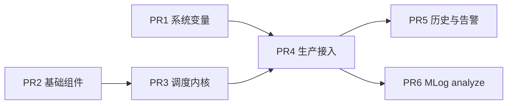

# MV service（原 PR7）拆分方案

更新日期：2026-10-29。

## 范围与基线

本文记录剩余 PR7 在完成 master port 之后的拆分方案。下文的 **PR1–PR6 是这次拆分的六个子 PR**，与此前已经完成 port 的原 PR1–PR6 无关。

完整实现保留在分支 `mv_pr7_service_for_master`，作为拆分时的最终行为参照：

| 项目 | 引用 |
| --- | --- |
| master 基线 | `fba22fa599b70bb8e688c8ca4fb6c287fd1a4d53` |
| 完整 port commit | `0bb0cdd796e984ff730288a64bcd345ca02845a4` |
| 原实现来源 | `cp_mv_for_master`，`fd4636bb442de52a1a5c6321f3f29092472aa6f4` |
| 原 port 范围说明 | `cp_mv_for_master_base:docs/note/materialized_view/mv_master_port_tracking.md` |
| 完整 port 规模 | 39 个文件，新增 12,617 行、删除 33 行，包含测试和生成的 Bazel 元数据 |

当前状态：完整 port 已完成验证并保存在上述 commit；六个子 PR 尚未实际创建，也尚未逐切片编译、测试。下文规模来自对最终 diff 的函数归属分析，包含测试，具体行数以实际拆分后的 diff 为准。

## 拆分原则

1. **尽量不引入只服务于拆分、随后就被删除的中间代码。** 每个 PR 都向最终实现递增；不添加临时生产 no-op handler、占位 SQL 实现、一次性适配层或仅用于拆分的开关。
2. 使用有先后依赖的 PR。每个中间版本在包含其前置 PR 后都应能编译，并验证当时已经引入的功能；不要求六个 PR 都直接基于 master 独立运行。
3. 接口方法、配置、状态、构造参数、循环调用、具体实现、指标和测试随对应功能一起加入。允许接口和构造函数正常扩展，不提前为后续功能补空实现。
4. 将新增 TiDB 系统变量统一放在 PR1；变量的运行时消费者和回调绑定随实际功能加入。
5. refresh 和 purge 保持配对，按“基础组件 → 调度内核 → 生产接入”分层。两者共用调度、并发分配、退避和生命周期，按任务类型拆开会反复修改同一条调用链。
6. 保留最终需要的测试 mock。将混合测试按职责一次移动到最终文件，不为某个中间 PR 单独制造随后废弃的测试架构。
7. 若实际切分发现某个边界需要大量一次性代码或重复重构，优先调整边界、合并耦合部分，不以 PR 数量优先。

## 总览与依赖

| PR | 内容 | 预计新增规模，含测试 | 语义依赖 |
| --- | --- | --- | --- |
| PR1 | 七个系统变量、最终回调槽位、变量测试 | 约 240 行，4 个已有文件，不含生成元数据 | master |
| PR2 | 执行器、队列、背压、哈希与成员发现接口、通知器、时钟 | 约 2.8k 行 | master；可接在 PR1 后 |
| PR3 | MVService refresh/purge 调度内核与模拟测试 | 约 2.5–3k 行 | PR2 |
| PR4 | SQL/元数据适配、Domain 启停、DDL 通知、变量绑定、基础监控 | 约 2.5–3k 行 | PR1、PR3 |
| PR5 | 操作历史维护、MV 刷新时效告警、MLog 堆积指标 | 约 3k 行 | PR4 |
| PR6 | MV service 调度 MLog analyze，接入统计信息模块 | 约 1k 行 | PR4；变量定义来自 PR1 |



建议实际合入顺序为 PR1 → PR2 → PR3 → PR4 → PR5 → PR6。PR5 与 PR6 没有语义依赖，可以交换；考虑到会修改同一组 service 文件，线性叠加可以减少冲突。

原先约 5.5k 行的自动 refresh/purge PR 在本方案中拆成 PR3 与 PR4，利用现有 `Helper` 接口分开调度内核和生产适配。

## PR1：新增 TiDB 系统变量

建议标题：`variable: add materialized view service system variables`。

取完整 port 中以下四个文件的最终改动：

- `pkg/sessionctx/vardef/tidb_vars.go`：名称和默认值。
- `pkg/sessionctx/variable/tidb_vars.go`：六个最终保留的原子回调槽位。
- `pkg/sessionctx/variable/sysvar.go`：SQL 注册、校验、setter 及回调 nil 检查。
- `pkg/sessionctx/variable/sysvar_test.go`：默认值、范围、回调与变量元数据测试。

| 变量 | 默认值 | 作用 | 运行时接入 |
| --- | --- | --- | --- |
| `tidb_mview_task_max` | `0` | refresh/purge 总并发；0 由 service 按 GOMAXPROCS 推导 | PR4 |
| `tidb_mview_task_refresh_ratio` | `0.6` | refresh 在总并发中的分配比例 | PR4 |
| `tidb_mview_task_threshold_cpu` | `0.8` | CPU 背压阈值 | PR4 |
| `tidb_mview_task_threshold_memory` | `0.8` | 内存背压阈值 | PR4 |
| `tidb_mview_refresh_hist_time` | `168` 小时 | refresh 历史保留时间 | PR5 |
| `tidb_mlog_purge_hist_time` | `168` 小时 | purge 历史保留时间 | PR5 |
| `tidb_mlog_auto_analyze_ratio` | `10.0` | MLog 修改量触发 analyze 的比例阈值 | PR6 |

六个回调槽位及 nil 检查已存在于完整实现，且不依赖 `pkg/mvservice`，因此可直接提前引入。前四个回调的 Domain 注册放 PR4，两个历史保留时间回调的注册放 PR5。analyze ratio 由 PR6 的扫描逻辑读取，不增加回调。

本 PR 合入后可以通过 SQL 校验、设置、查询和持久化变量；实际调度效果随消费者加入。Domain 的 `RebuildSysVarCache` 会用已保存的全局值调用 setter，后续接入消费者时应验证配置初始化与回调注册顺序。

验证重点：`TestMVServiceGlobalSysVars`、`TestTiDBMLogAutoAnalyzeRatio`，以及 SQL 侧变量设置、查询和持久化行为。

## PR2：服务基础组件

建议标题：`mvservice: add scheduling primitives and task executors`。

引入以下最终生产文件及相应测试：

- `pkg/mvservice/backpressure.go`
- `pkg/mvservice/consistenthash.go`
- `pkg/mvservice/executor.go`
- `pkg/mvservice/server_maintainer.go`
- `pkg/mvservice/utils.go`
- `pkg/mvservice/time_proxy.go`
- `pkg/mvservice/time_proxy_intest.go`

这些文件共约 1,454 行，包含任务执行器、任务队列、背压、consistent hash、基于 `ServerDiscovery` 接口的成员维护、优先队列、通知器与真实/测试时钟，不依赖 `MVService` 或具体 `serviceHelper`。真实 infosync 成员发现提供者放 PR4。

`server_maintainer_test.go`、`utils_test.go`、`time_proxy_test.go` 可以随组件引入。另从当前混合的 `mvservice_test.go` 中取出 executor、backpressure、task queue 测试和独立等待/断言工具，一次放入最终归属文件，例如 `executor_test.go`。此阶段不提前引入 service 专用 mock。

本 PR 提供可直接测试的组件，生产启动在 PR4 接入。

验证重点：组件单元测试和 race 检查，覆盖任务执行/停止、背压、拓扑变化、归属稳定性和确定性时钟。

## PR3：MVService 调度内核

建议标题：`mvservice: add refresh and purge scheduling engine`。

从以下混合文件中按功能引入内核部分：

- `pkg/mvservice/service.go`
- `pkg/mvservice/service_settings.go`
- `pkg/mvservice/task_handler.go`
- `pkg/mvservice/test_helpers_test.go`
- `pkg/mvservice/mvservice_test.go`
- `pkg/mvservice/task_handler_test.go`

包含真正的 refresh/purge 调度行为：配对任务队列、节点归属过滤、拓扑/DDL 唤醒、元数据更新的原子应用、到期任务派发、执行结果处理、失败指数退避、手动取消后的退避状态转换、并发配置及执行器生命周期。

拆分依赖当前已有的接口边界：

```go
type Helper interface {
    ServerDiscovery
    MVTaskHandler
    MVMetricsReporter
}

func NewMVService(ctx context.Context, se basic.SessionPool, helper Helper, cfg Config) *MVService
```

内核通过 `Helper` 访问外部能力，不依赖具体 `serviceHelper`、infosync、InfoSchema 或 SQL 执行 API。此时 `MVTaskHandler` 只包含已经由内核使用的 refresh、purge、schedule load、手动取消退避等方法；PR5/PR6 再随真实实现增加各自方法。

内存中的基础计数及 `MVMetricsReporter` 接口随内核加入，具体 Prometheus 实现在 PR4。历史、告警、analyze 的状态、配置分支和 tick 调用分别留给 PR5/PR6。

测试使用最终保留的 `mockMVServiceHelper`、可脚本化成员发现和完整调度链路模拟，验证节奏、归属、拓扑、配置、删除、错误和退避行为。手动取消的调度状态转换在本 PR 验证，对应事务 SQL 在 PR4 验证。

本 PR 合入后有完整可测试的调度内核，生产启动和真实 SQL 适配在 PR4 一起加入。无需临时默认 Helper 或生产空 handler。

验证重点：内核中间版本的独立编译、调度测试和 race 检查；确认接口均由最终保留的测试实现满足。

## PR4：生产适配与自动 refresh/purge 接入

建议标题：`mvservice, domain: integrate automatic materialized view maintenance`。

引入具体 `serviceHelper`、生产监控实现和启动接线。主要涉及：

- `pkg/mvservice/service_helper.go`、`metrics_reporter.go` 中的核心部分。
- `pkg/domain/domain.go`、`domain_sysvars.go`。
- `pkg/session/session.go`、`pkg/ddl/notifier/subscribe.go`。
- `pkg/metrics/materialized_view.go`、`metrics.go`、`grafana/tidb.json`。
- `pkg/executor/test/materializedview/materialized_view_service_test.go` 中的自动 refresh/purge 测试。

具体范围：

1. infosync 成员发现，同一 IP:port 的实例去重；InfoSchema 和系统表中的调度信息读取。
2. `RefreshMV`、`PurgeMVLog` 真实 SQL 调用，全局 maintenance session 参数的应用及池化 session 的恢复，restricted SQL 工具。
3. 手动取消后的事务性重调度 SQL，与 PR3 的状态转换接通。
4. 默认 Helper 构造、`RegisterMVService`、DDL handler ID 和回调注册、Domain/session 启停、跨 TiDB DDL 通知。
5. PR1 中四个并发/背压变量的回调注册。
6. 基础 Prometheus 指标、panic 指标与 Grafana；历史/告警/analyze 专属指标使用随对应功能加入。

本 PR 给已有内核提供最终的生产实现并激活服务。refresh/purge 的失败重试、手动取消与 session 恢复语义必须一起接通，避免先上线不完整的调度行为。

`statsHandleGetter`、`sysProcTracker` 只被 analyze 使用，其字段、构造参数和 Domain 传参留到 PR6；不为提前固定最终签名而引入假 provider。

验证重点：成员提供者、调度信息读取、SQL/事务、参数恢复、持久化退避、注册与启停测试，`TestMaterializedViewServiceAutomaticMaintenance`，以及生产启动的相关 SQL 集成测试。

## PR5：操作历史与告警维护

建议标题：`mvservice: maintain operation history and alert state`。

本 PR 将三个后台维护任务放在一起，预计约 3k 行。这是为控制评审规模而做的分组，三者之间没有必须同 PR 引入的编译依赖。

### 操作历史维护

维护 `mysql.tidb_mview_refresh_hist` 和 `mysql.tidb_mlog_purge_hist`：按保留时间和数量上限分批清理；将长时间无心跳的 `running` 记录标记为 `orphaned`。

包含 `maybeGCOperationHistory`、`runGCOperationHistory`、GC 重试/调度、保留配置，及 `GetCurrentTSO`、`PurgeMVHistoryBeforeTSO` 和相应批量 SQL 工具。两个历史保留时间变量的 service setter 和 Domain 回调绑定同时加入。

基础历史写入和刷新失败标记已经由此前的 refresh/purge port 提供。本 PR 增加的是 service 周期性维护。

### MV 刷新时效告警

按最近一次成功刷新的 snapshot/read TSO 时间计算数据新鲜度，根据对象配置分为 warning/overdue。将状态写入 `mysql.tidb_mview_refresh_alert`，输出日志和指标，并清理恢复正常、已删除或关闭告警对象的残留状态。

包含 `maybeLogRefreshAlertTasks`、`classifyRefreshAlertLevel`、告警检查与清理的归属逻辑，以及 `SyncMVRefreshAlertStates`、`CleanupStaleMVRefreshAlerts`。

### MLog 堆积指标

定期读取配置了行数阈值的 MLog，统计 **当前行数严格大于阈值** 的对象数量并上报 gauge。包含 `maybeScanMVLogAccumulationAlerts`、`LoadAllTiDBMVLogAccumulationTasks` 和 `LoadTiDBMVLogAccumulationRowCounts`。

完整实现中的这项功能输出超阈值对象数量指标，尚无逐 MLog 的持久化告警记录；查询失败会记录日志。

三个任务各自的状态、缓存、配置、接口方法、service tick 调用、SQL 实现和测试随本 PR 加入。

验证重点：历史清理/孤儿记录/重试、保留时间动态调整、时效告警分级与恢复清理、MLog 阈值边界、重复扫描和节点归属，以及相应 SQL 与指标。

## PR6：MV service 调度 MLog analyze

建议标题：`mvservice, statistics: schedule materialized view log analysis`。

MLog analyze 是可以独立评审的功能，由 MV service 扫描候选对象、确定节点归属并调度专用执行器，底层复用 statistics 的 analyze 能力。

具体范围：

1. `needAnalyzeMLog`、`LoadAllTiDBMVLogAnalyzeTasks`、`AnalyzeMVLog`，读取 PR1 的 analyze ratio，判断候选、扫描、去重和派发。
2. analyze 专用执行器、并发配置、生命周期、背压、运行状态、指标与循环调用。
3. `serviceHelper` 的 `statsHandleGetter`、`sysProcTracker` 字段，以及构造/注册函数和 Domain 的对应传参。
4. `pkg/statistics/handle/util/util.go` 中新增的 `UpdateSCtxVarsForStatsWithRestore` 及测试，保证统计任务设置对池化 session 的修改能够恢复，保留 master 现有共享 API。
5. `pkg/statistics/handle/autoanalyze/priorityqueue/{queue.go,queue_ddl_handler.go,queue_test.go}` 中对 MLog 的排除，覆盖初始化、DML 更新及 DDL/index 重建路径。
6. `TestMaterializedViewServiceMLogAnalyze` 真实 SQL 测试。

**普通 auto-analyze priority queue 排除 MLog，必须与替代它的 service analyze 调度同 PR 合入。** 前面的 PR 保持原来的分析调度行为，避免中间版本失去 MLog 自动分析能力。

验证重点：候选条件、扫描去重与归属、执行器生命周期、统计 session 的成功/部分失败/惰性变量恢复、priority queue 排除行为及实际 analyze SQL。

## 跨 PR 的代码归属

`service.go`、`service_settings.go`、`service_helper.go` 和几个测试文件混合了多项功能，实际拆分应按函数、字段、配置分支和调用点归属切分，不能提前整文件复制。

| 位置或能力 | 加入时机 |
| --- | --- |
| 六个最终变量回调槽位及 nil 检查 | PR1 |
| 四个 task/concurrency/backpressure 回调注册 | PR4 |
| 两个 history retention 回调注册 | PR5 |
| `MVTaskHandler`、`Config`、构造参数 | PR3 建立内核所需部分；后续随功能扩展 |
| 内存基础计数与指标接口 | PR3 |
| 公共 Prometheus 指标实现、Domain panic 接线和 Grafana | PR4 |
| 历史/告警/analyze 的专属状态与指标使用 | PR5 / PR6 |
| statistics handle、process tracker、统计 session restore 工具 | PR6 |
| MLog 从普通 auto-analyze priority queue 移出 | PR6，与 service 调度同时加入 |
| 混合测试中的共享工具 | 放入首次真实使用它的 PR，保留最终归属；后续只扩展功能相关部分 |
| `BUILD.bazel` 等生成元数据 | 每个 PR 随各自源码和测试生成，不手工补最终版本 |

## 拆分验证与完成标准

每个 PR 按当时实际变更应用仓库 [AGENTS.md](../../../AGENTS.md) 与 [测试流程](../../agents/testing-flow.md) 的构建准备、failpoint 和交付检查；新增/移动 Go 文件、调整 import 或新增测试等触发条件出现时，先运行 `make bazel_prepare` 并纳入生成结果。

按前文各 PR 的验证重点运行最小有效测试集。PR2/PR3 特别验证只有基础组件/内核的中间版本；PR4 验证首次生产启用，PR6 验证 analyze 调度接替。后续阶段对已有测试的增加应只涉及对应新能力。

最终检查：

- 每个 PR 在前置 PR 上可编译，并通过对应功能测试。
- 完整 port 的 95 个 service 测试和新增 SQL/共享模块测试都有明确归属；移动测试保留其覆盖。
- 不存在仅为中间版本编译而引入、在最终版本废弃的生产实现。
- 最后一个 PR 的累积实现与完整 port commit 比较，除有意保留的测试文件组织调整、生成元数据变化及经确认的改进外，行为与范围一致。
- 保持 master 的 UTC NEXT 调度、当前 InfoSchema API 和 analyze version 2 等 port 适配结果。

完整 port 的已有验证包括全部 95 个 service 测试及 race、变量/priority queue/session restore 的定向测试、真实自动 refresh/purge/analyze SQL、race 生产二进制上的 `executor/mview_refresh_entry`（45 条 SQL）、`make lint` 与当时执行的 Bazel 检查。这些可作为最终行为参照，不能替代各拆分版本的编译和测试。

已有验证未覆盖真实多 TiDB 成员变更/故障切换、RealTiKV、NextGen 运行及资源压力/性能基准；本方案不据此承诺相应结果。
